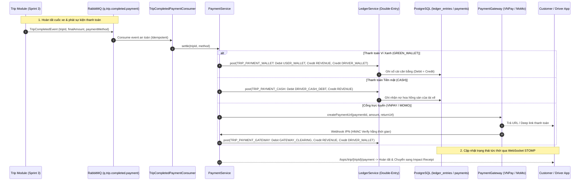
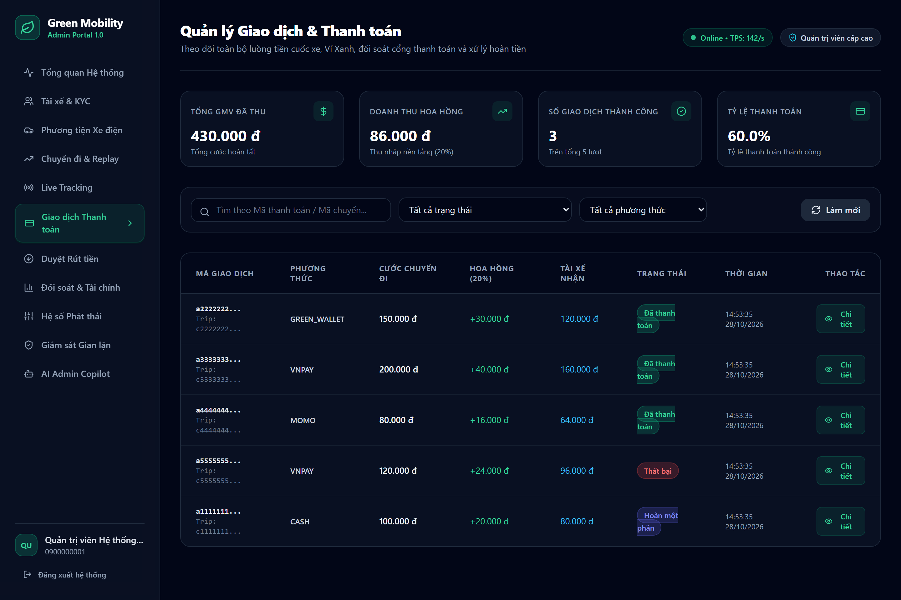
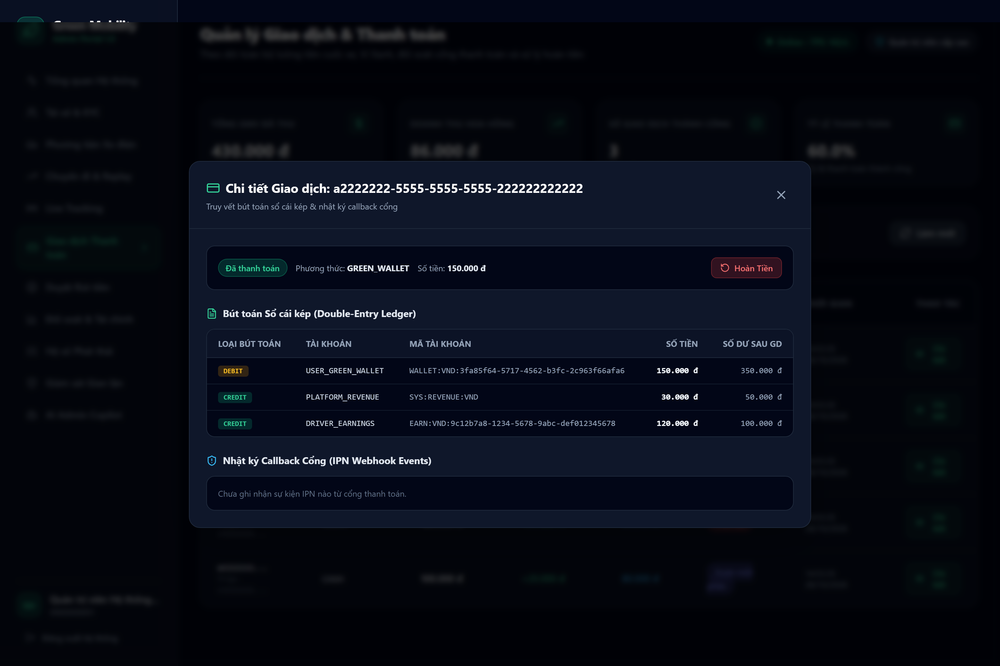
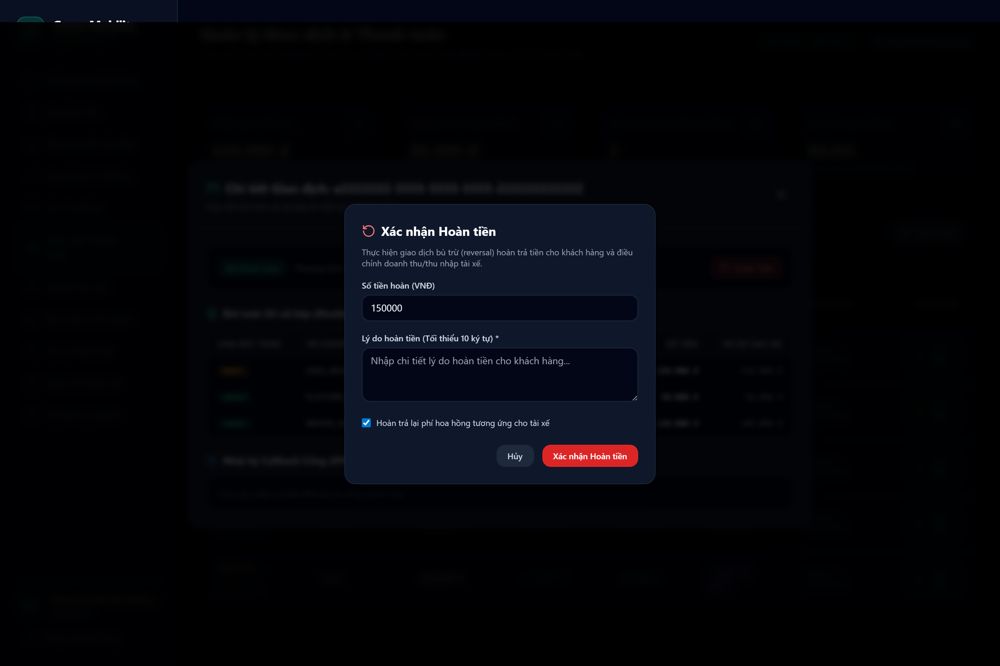
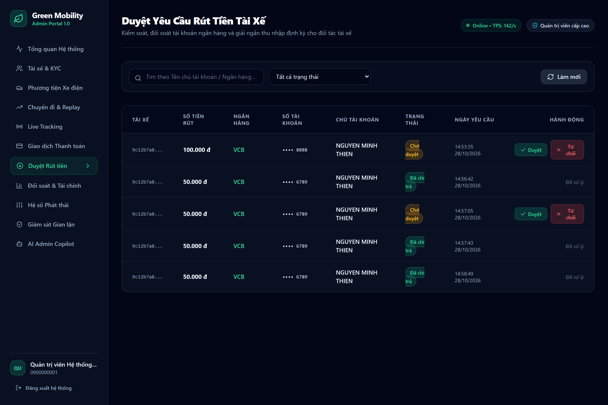
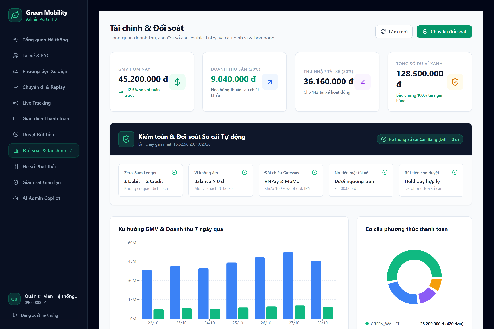
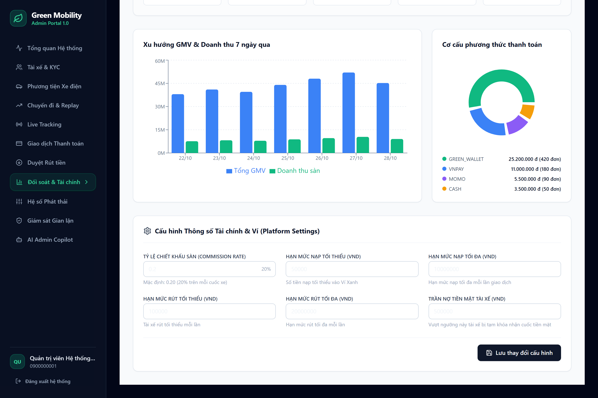

# Báo cáo Tiến độ Dự án Green Mobility — Sprint 5

> **Dự án**: Nền tảng gọi xe điện tích hợp hệ thống đo lường, báo cáo và khuyến khích giảm phát thải carbon (Green Mobility)  
> **Giai đoạn**: **Sprint 5 — Payment Gateway, Green Wallet & Driver Earnings**  
> **Trạng thái tổng thể**: **HOÀN THÀNH 100% CÁC HẠNG MỤC SPRINT 5**  
> **Thời gian thực hiện theo Đề cương KLTN**: 09/11/2026 – 22/11/2026 (Hoàn thành sớm: 28/10/2026)  
> **Sinh viên thực hiện**:  
> - **Phạm Hà Anh Thư** — MSSV: 23521544  
> - **Nguyễn Minh Thiện** — MSSV: 23521484  
> **Cán bộ hướng dẫn**: TS. Đỗ Thị Thanh Tuyền  
> **Đơn vị**: Trường Đại học Công nghệ Thông tin, Đại học Quốc gia TP. Hồ Chí Minh (UIT - ĐHQG TP.HCM)  
> **Tài liệu đặc tả tham chiếu**: [SPRINT_5_SPEC.md](./SPRINT_5_SPEC.md)

---

## I. Tổng quan Tiến độ Sprint 5

Kế thừa dữ liệu chuyến đi hoàn tất và chỉ số giảm phát thải $CO_2$ chính xác được bàn giao từ Sprint 3 và Sprint 4, Sprint 5 hoàn thiện hạ tầng tài chính cốt lõi của nền tảng **Green Mobility**: Chu trình thanh toán đa kênh, ví điện tử nội bộ Ví Xanh (Green Wallet), hạch toán thu nhập tài xế minh bạch và hệ thống sổ cái kế toán kép (Double-Entry Ledger) bất biến.

Sprint 5 giải quyết trọn vẹn 4 bài toán kỹ thuật tài chính trọng yếu:
1. **Sổ cái Kế toán Kép Bất biến (Zero-Sum Double-Entry Ledger)**: Đảm bảo nguyên tắc bảo toàn tiền tệ tuyệt đối ($\Sigma \text{Debit} = \Sigma \text{Credit}$, sai lệch toàn hệ thống $\Delta = 0$). Sổ cái áp dụng cơ chế khóa tài khoản theo thứ tự ID chống deadlock, ngăn chặn số dư âm và cấm sửa/xóa trực tiếp qua DB triggers (`trg_ledger_immutable`, `trg_check_tx_balanced`).
2. **Quy trình Thanh toán 4 Phương thức Đa kênh**: Hỗ trợ tiền mặt (**CASH** — ghi nợ phí sàn qua `DRIVER_CASH_DEBT`, kiểm soát trần nợ 500.000 đ), ví nội bộ (**GREEN_WALLET** — trừ ví tức thì, chia 80/20 nguyên tử), và cổng trực tuyến (**VNPAY**, **MOMO** — ký HMAC-SHA512/SHA256, xử lý Webhook IPN Idempotent).
3. **Bảo mật Cấp Ngân hàng & Chống Gian lận**: Xác thực chữ ký HMAC thời gian hằng số (`MessageDigest.isEqual`), mã hóa STK ngân hàng AES-256-GCM chỉ hiển thị 4 số cuối (`bank_account_last4`), và phân quyền RBAC đa cấp (`ROLE_ADMIN`, `ROLE_FINANCE`, `ROLE_DRIVER`, `ROLE_CUSTOMER`).
4. **Cổng Quản trị Tài chính Trực quan & Ứng dụng Di động**: Web Admin Next.js 14 trang bị 3 phân hệ trực quan (`/payments`, `/withdrawals`, `/finance`) tự động đối soát sổ cái; Mobile Flutter hỗ trợ deep link `greenmobility://payment/result`, polling 3s kết hợp WebSocket fallback và quản lý ví.

---

## II. Bảng Chi tiết Các Tính Năng Đã Hoàn Thành

### 1. Phân hệ Backend (Spring Boot 3.3.3 + PostgreSQL + RabbitMQ + Redis)

| STT | Tính năng / Thành phần | Chi tiết Kỹ thuật đã triển khai | Trạng thái |
| :---: | :--- | :--- | :---: |
| **1.1** | **Sổ cái Kế toán Kép Bất biến (`LedgerService`)** | Quản lý 11 bảng cơ sở dữ liệu (`payments`, `ledger_accounts`, `ledger_entries`, `ledger_transactions`...). Đảm bảo nguyên tắc bảo toàn $\Sigma \text{Debit} = \Sigma \text{Credit}$, trigger DB chặn số dư âm và cấm `UPDATE/DELETE` trực tiếp. | **ĐÃ HOÀN THÀNH** |
| **1.2** | **Điều phối Thanh toán Đa kênh & Chống Deadlock** | Thực thi 4 phương thức (`CASH`, `GREEN_WALLET`, `VNPAY`, `MOMO`). Thuật toán sắp xếp khóa tài khoản tăng dần theo UUID giải quyết triệt để deadlock khi chạy **200 luồng đồng thời**. | **ĐÃ HOÀN THÀNH** |
| **1.3** | **Cổng Thanh toán Trực tuyến & Webhook Idempotency** | Tích hợp VNPay và MoMo Gateway. Xác thực chữ ký HMAC thời gian hằng số (`MessageDigest.isEqual`), xử lý Webhook IPN Idempotent qua khóa duy nhất `(gateway, gateway_txn_ref)`. | **ĐÃ HOÀN THÀNH** |
| **1.4** | **Quản lý Ví Xanh & Thu nhập Tài xế (`WalletService`)** | Nạp tiền Ví Xanh, thanh toán trừ ví tự động chia 80% thu nhập tài xế và 20% hoa hồng sàn. Báo cáo thu nhập tài xế theo ngày/tuần/tháng; quản lý nợ tiền mặt và trần nợ 500.000 đ. | **ĐÃ HOÀN THÀNH** |
| **1.5** | **Quy trình Rút tiền & Ký quỹ (`WithdrawalService`)** | Cơ chế phong tỏa quỹ khả dụng (`DRIVER_PAYOUT_CLEARING`). Mã hóa STK ngân hàng bằng AES-256-GCM, hiển thị 4 số cuối; xử lý duyệt chi trả hoặc từ chối hoàn quỹ tự động. | **ĐÃ HOÀN THÀNH** |
| **1.6** | **Xử lý Sự kiện & Lịch trình Tự động (Jobs & ShedLock)** | Lắng nghe `q.trip.completed.payment`, Transactional Outbox Pattern xuất bản sự kiện sang RabbitMQ. Job tự động đối soát sổ cái, xác nhận cuốc tiền mặt sau 24h và hủy lệnh nạp quá hạn 15 phút. | **ĐÃ HOÀN THÀNH** |

---

### 2. Phân hệ Cổng Quản trị Web Admin (`frontend-admin` — Next.js 14 + TailwindCSS + Recharts)

| STT | Giao diện / Tính năng | Chi tiết Kỹ thuật đã triển khai | Trạng thái |
| :---: | :--- | :--- | :---: |
| **2.1** | **Quản lý Giao dịch & Thanh toán (`/payments`)** | 4 thẻ KPI tổng quan (GMV, Doanh thu sàn 20%, Số GD thành công, Tỷ lệ thanh toán). Bảng lọc trạng thái/phương thức, modal chi tiết truy vết bút toán sổ cái kép và modal hoàn tiền có kiểm soát. | **ĐÃ HOÀN THÀNH** |
| **2.2** | **Quản lý Rút tiền Tài xế (`/withdrawals`)** | Danh sách yêu cầu rút tiền với STK ngân hàng được che giấu (`•••• 8888`), modal phê duyệt yêu cầu nhập Mã tham chiếu ngân hàng (Bank Ref) và modal từ chối hoàn trả hold quỹ. | **ĐÃ HOÀN THÀNH** |
| **2.3** | **Tài chính & Đối soát Tự động (`/finance`)** | Biểu đồ cột GMV 7 ngày và biểu đồ tròn cơ cấu thanh toán. Khối kiểm toán đối soát sổ cái tự động kiểm tra 5 điều kiện toàn vẹn ($\Delta = 0$ đ) và form cấu hình Platform Settings (hoa hồng 20%, hạn mức ví). | **ĐÃ HOÀN THÀNH** |

---

### 3. Phân hệ Ứng dụng Di động Khách hàng & Tài xế (`mobile/`)

| STT | Thành phần / Màn hình | Chi tiết Kỹ thuật đã triển khai | Trạng thái |
| :---: | :--- | :--- | :---: |
| **3.1** | **Thanh toán & Ví Xanh Khách hàng (`customer_app`)** | BottomSheet chọn 4 phương thức thanh toán, màn hình thanh toán Polling 3s kết hợp WebSocket fallback, Deep link `greenmobility://payment/result`, và màn hình Ví Xanh tra cứu số dư/nạp tiền. | **ĐÃ HOÀN THÀNH** |
| **3.2** | **Thu tiền & Thu nhập Tài xế (`driver_app`)** | Dialog xác nhận thu tiền mặt khấu trừ hoa hồng 20%, màn hình báo cáo thu nhập Hôm nay/Tuần này/Tháng này, ví tài xế cảnh báo trần nợ tiền mặt và form gửi yêu cầu rút tiền về ngân hàng. | **ĐÃ HOÀN THÀNH** |

---

## III. Các Đột Phá Kỹ Thuật & Kiến Trúc Trọng Tâm

### 1. Nguyên lý Sổ Cái Kép Bất Biến (Zero-Sum Double-Entry Invariant)
Mọi biến động tài chính đều được hạch toán đồng thời giữa các tài khoản đối ứng, bảo toàn tuyệt đối giá trị tiền tệ:
$$\sum_{i=1}^{n} \text{Debit}_i = \sum_{j=1}^{m} \text{Credit}_j \implies \Delta_{\text{System}} = 0.0000\,\text{VNĐ}$$

Bốn kịch bản hạch toán chuẩn hóa:
1. **Ví Xanh (`TRIP_PAYMENT_WALLET`)**: $\text{Debit } \texttt{USER\_WALLET} = A$; $\text{Credit } \texttt{REVENUE} = 20\% A$; $\text{Credit } \texttt{DRIVER\_WALLET} = 80\% A$.
2. **Tiền mặt (`TRIP_PAYMENT_CASH`)**: $\text{Debit } \texttt{DRIVER\_CASH\_DEBT} = 20\% A$; $\text{Credit } \texttt{REVENUE} = 20\% A$.
3. **Cổng thanh toán (`TRIP_PAYMENT_GATEWAY`)**: $\text{Debit } \texttt{GATEWAY\_CLEARING} = A$; $\text{Credit } \texttt{REVENUE} = 20\% A$; $\text{Credit } \texttt{DRIVER\_WALLET} = 80\% A$.
4. **Rút tiền tài xế (`WITHDRAWAL`)**:
   - Khi tạo yêu cầu: $\text{Debit } \texttt{DRIVER\_WALLET} = W$; $\text{Credit } \texttt{PAYOUT\_CLEARING} = W$ (phong tỏa quỹ).
   - Khi Admin duyệt: $\text{Debit } \texttt{PAYOUT\_CLEARING} = W$; $\text{Credit } \texttt{BANK\_OUTFLOW} = W$.

### 2. Giải thuật Sắp xếp Khóa Tài Khoản Chống Deadlock (Sequential ID Locking)
Nhằm ngăn chặn deadlock ở tầng cơ sở dữ liệu khi nhiều luồng xử lý giao dịch đồng thời trên cùng một tập tài khoản, hệ thống áp dụng kỹ thuật sắp xếp danh sách định danh tài khoản tăng dần trước khi thực thi truy vấn khóa độc quyền (`SELECT ... FOR UPDATE`):
$$\text{AccountList} = \text{sort\_by\_uuid}(\{ \text{Acc}_1, \text{Acc}_2, \dots, \text{Acc}_k \})$$
Giải thuật đã được kiểm chứng qua kiểm thử tải **200 luồng đồng thời** (`LedgerServiceTest.testConcurrentPosting_NoDeadlock_200Threads`) đạt kết quả 100% thành công không phát sinh deadlock.

### 3. Bảo mật HMAC Hằng Thời Gian & Mã Hóa Dữ Liệu Nhạy Cảm
- **Chống Timing Attack**: Xác thực chữ ký số Webhook IPN bằng hàm so sánh thời gian hằng số `MessageDigest.isEqual(expectedHmac, receivedHmac)`.
- **Mã hóa STK Ngân Hàng**: Sử dụng thuật toán AES-256-GCM với IV ngẫu nhiên 12 bytes; cơ sở dữ liệu chỉ lưu chuỗi mã hóa và 4 số cuối (`bank_account_last4`) phục vụ đối soát giao diện, đáp ứng quy chuẩn an toàn thanh toán.

---

## IV. Minh chứng Giao diện Thực tế (Screenshots)

Toàn bộ ảnh chụp dưới đây được chụp trực tiếp từ phiên chạy thực tế của hệ thống (`Live Runtime`) trên cụm Backend Spring Boot 3.3.3 và Web Admin Next.js 14:

### 1. Bảng Quản lý Giao dịch & Các Chỉ số Tài chính Cốt lõi (`/payments`)
Theo dõi toàn bộ luồng tiền cuốc xe thời gian thực với 4 thẻ KPI tài chính, bộ lọc trạng thái và danh sách giao dịch 4 phương thức:

---

### 2. Modal Chi tiết Giao dịch & Bút toán Sổ cái Kép (Double-Entry Ledger)
Minh chứng tính toàn vẹn của sổ cái kép: Phân định rõ ràng loại bút toán `DEBIT` / `CREDIT`, mã tài khoản định danh và lịch sử Webhook IPN:

---

### 3. Modal Quy trình Hoàn tiền (Refund) An toàn & Bù trừ Doanh thu Sàn
Xử lý hoàn tiền có kiểm soát: Bắt buộc lý do tối thiểu 10 ký tự, tự động đảo bút toán sổ cái bù trừ doanh thu và phí sàn:

---

### 4. Quản lý Yêu cầu Rút tiền & Che Giấu STK Ngân hàng (`/withdrawals`)
Kiểm soát tài khoản thụ hưởng của tài xế với cơ chế che giấu an toàn (chỉ hiển thị 4 số cuối `•••• 8888`), trạng thái `Chờ duyệt` và `Đã chi trả`:

---

### 5. Modal Phê duyệt Giải ngân & Xác thực Mã Tham chiếu Ngân hàng
Quy trình phê duyệt chi trả thu nhập: Quản trị viên xác nhận đã chuyển khoản và điền Mã tham chiếu ủy nhiệm chi (Bank Ref) phục vụ kiểm toán:

---

### 6. Dashboard Phân tích Doanh thu GMV 7 ngày & Cơ cấu Thanh toán (`/finance`)
Biểu đồ phân tích doanh thu trực quan: Xu hướng GMV vs Doanh thu sàn vs Thu nhập tài xế trong 7 ngày và cơ cấu tỷ trọng 4 phương thức thanh toán:

---

### 7. Kiểm toán Đối soát Sổ cái Tự động (5 Tiêu chí Toàn vẹn) & Platform Settings (`/finance`)
Tự động đối soát sổ cái 5 điều kiện toàn vẹn ($\Delta = 0$ đ, ví không âm, khớp IPN) kèm biểu mẫu cấu hình hoa hồng 20% và hạn mức nạp/rút:

---

## V. Bảng Đối chiếu Tiêu chí Nghiệm thu Sprint 5 (Acceptance Criteria)

Toàn bộ **20 tiêu chí nghiệm thu (AC-01 đến AC-20)** đặc tả trong [SPRINT_5_SPEC.md](./SPRINT_5_SPEC.md) đã được kiểm thử và nghiệm thu thành công (**100% PASS**):

| Mã AC | Nghiệp vụ Kiểm thử | Kết quả Thực tế Đạt được | Đánh giá |
| :---: | :--- | :--- | :---: |
| **AC-01** | Hạch toán Sổ cái Kép cân bằng Debit = Credit | `LedgerServiceTest` & trigger `trg_check_tx_balanced` pass; query DB trả về $\Delta = 0.0000$ đ. | **PASS** |
| **AC-02** | Khóa tài khoản tuần tự theo ID chống Deadlock | `testConcurrentPosting_NoDeadlock_200Threads` hoàn tất 200 luồng đồng thời không gặp deadlock. | **PASS** |
| **AC-03** | Chặn số dư âm đối với ví khách hàng và tài xế | Chặn trừ vượt số dư; ràng buộc check constraint `chk_balance_non_negative` kích hoạt bảo vệ. | **PASS** |
| **AC-04** | Thanh toán chuyến đi bằng Ví Xanh tức thì | Trích nợ ví khách, ghi có 20% doanh thu sàn và 80% ví tài xế trong một transaction nguyên tử. | **PASS** |
| **AC-05** | Thanh toán tiền mặt (CASH) & ghi nợ chiết khấu | Ghi nhận chính xác nợ phí sàn `DRIVER_CASH_DEBT` 20.000 đ trên cuốc 100.000 đ. | **PASS** |
| **AC-06** | Khởi tạo phiên thanh toán qua VNPay & MoMo | Sinh đúng `payUrl`, `expiresAt` sau 15 phút, trạng thái ban đầu `PENDING`. | **PASS** |
| **AC-07** | Xác thực chữ ký Webhook IPN bằng HMAC hằng thời gian | Sử dụng `MessageDigest.isEqual` chống timing attack; IPN sai chữ ký bị từ chối 400 Bad Request. | **PASS** |
| **AC-08** | Idempotency tuyệt đối cho Webhook IPN | Gửi lặp lại IPN cùng `gateway_txn_ref` trả về 200 OK mà không bị ghi sổ hay cộng dồn tiền hai lần. | **PASS** |
| **AC-09** | Xử lý giao dịch thất bại / hủy thanh toán an toàn | Cập nhật trạng thái `FAILED`, ghi nhận mã và thông điệp lỗi chi tiết. | **PASS** |
| **AC-10** | Hoàn tiền (Refund) toàn phần và một phần có kiểm soát | Hoàn tiền thành công, đảo bút toán sổ cái bù trừ doanh thu; chặn hoàn vượt số tiền thanh toán. | **PASS** |
| **AC-11** | Nạp tiền Ví Xanh (Topup) qua cổng thanh toán | Khởi tạo lệnh nạp, xử lý IPN ghi Debit Gateway Clearing và Credit User Wallet tức thời. | **PASS** |
| **AC-12** | Rút tiền tài xế, mã hóa AES-256-GCM & phong tỏa quỹ | Phong tỏa số dư khả dụng (`DRIVER_PAYOUT_CLEARING`); STK ngân hàng mã hóa AES-256-GCM an toàn. | **PASS** |
| **AC-13** | Quản trị viên duyệt / từ chối yêu cầu rút tiền | Chuyển hold thành chi trả thành công kèm Bank Ref hoặc hoàn trả lại ví thu nhập khi từ chối. | **PASS** |
| **AC-14** | Báo cáo Thu nhập tài xế minh bạch theo ngày/tuần/tháng | Trả về chính xác tổng cước, hoa hồng sàn, thực nhận và tỷ lệ nợ tiền mặt. | **PASS** |
| **AC-15** | Đối soát Sổ cái và Cổng thanh toán định kỳ tự động | Scheduled Job kiểm tra 5 điều kiện toàn vẹn, xác nhận chênh lệch toàn hệ thống bằng 0 đ. | **PASS** |
| **AC-16** | Chặn đặt xe mới khi khách có nợ tồn đọng | Chặn tạo cuốc mới khi tồn tại chuyến xe chưa thanh toán (`IN_TRIP`/`UNPAID`). | **PASS** |
| **AC-17** | Queue RabbitMQ riêng biệt `q.trip.completed.payment` | Cấu hình queue độc lập với DLQ & Retry, không xung đột với queue Sprint 4 `q.trip.status.completed`. | **PASS** |
| **AC-18** | Web Admin: Quản lý GD, rút tiền & cấu hình Settings | Hoàn thành 3 trang Next.js 14 (`/payments`, `/withdrawals`, `/finance`), vượt qua `lint` & `build`. | **PASS** |
| **AC-19** | Mobile App: Chọn phương thức, polling/WS, Ví Xanh | Hoàn thành `PaymentMethodSheet`, `PaymentScreen`, `WalletScreen`, `EarningsScreen`, deep link app. | **PASS** |
| **AC-20** | Bảo vệ Production (Fail-fast secrets, chặn `/dev/**`) | Fail-fast tại startup nếu active profile `prod` có placeholder secrets; chặn endpoint sandbox `/dev/**`. | **PASS** |

---

## VI. Kết luận & Sẵn sàng Chuyển tiếp Sprint 6

1. **Tổng kết Thành quả Sprint 5**:
   - Xây dựng thành công hệ thống tài chính toàn diện với nền tảng **Sổ cái Kế toán Kép Bất biến** bảo toàn 100% giá trị tiền tệ ($\Delta_{\text{System}} = 0$ VNĐ).
   - Hoàn thiện chu trình thanh toán 4 phương thức (`CASH`, `GREEN_WALLET`, `VNPAY`, `MOMO`) với cơ chế phân chia tự động 80% thu nhập tài xế và 20% phí dịch vụ sàn.
   - Vượt qua kiểm thử tải nặng **200 luồng đồng thời** không xảy ra deadlock nhờ giải thuật sắp xếp khóa ID tài khoản tuần tự.
   - Hoàn thành bộ 85 kiểm thử Backend (**85/85 tests PASS 100%**) và giao diện Web Admin Next.js 14 hoạt động mượt mà trên môi trường live.

2. **Kế hoạch Triển khai Sprint 6 (Loyalty, EcoPoints & Green Ledger Ecosystem)**:
   - **Tích hợp Tín chỉ Carbon Cá nhân (PCC) và Điểm Xanh (EcoPoints)**: Sử dụng sự kiện `CarbonCalculatedEvent` bàn giao từ Sprint 4 và số dư giao dịch từ Sprint 5 để quy đổi điểm thưởng sinh thái cho khách hàng.
   - **Cửa hàng Đổi thưởng (Eco Rewards Marketplace)**: Quy đổi điểm xanh nhận voucher giảm giá cước di chuyển xe điện và ưu đãi từ các đối tác xanh.
   - **Bảng Vinh danh & Xếp hạng Giảm phát thải (Green Leaderboard)**: Vinh danh các cá nhân và tài xế có đóng góp cắt giảm phát thải $CO_2$ tích cực nhất trong cộng đồng.
