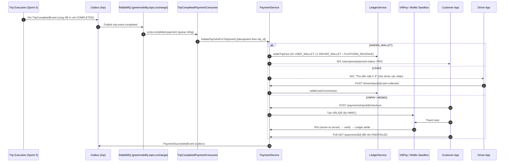

# Sprint 5 Specification: Payment Gateway, Green Wallet & Driver Earnings

> **Tài liệu**: Đặc tả Kỹ thuật Chi tiết Sprint 5 (Sprint 5 Specification)  
> **Dự án**: Nền tảng gọi xe điện tích hợp hệ thống đo lường, báo cáo và khuyến khích giảm phát thải carbon (Green Mobility)  
> **Thời gian thực hiện theo Đề cương KLTN**: 09/11/2026 – 22/11/2026  
> **Mục tiêu**: Xây dựng hệ thống thanh toán end-to-end cho chuyến đi: thanh toán đa kênh (Tiền mặt, Ví Xanh nội bộ, VNPay Sandbox, MoMo Sandbox); Ví Xanh (Green Wallet) vận hành trên **sổ cái kép (double-entry ledger)** bằng tiền VND; tự động chia doanh thu (hoa hồng nền tảng / thu nhập tài xế); nạp ví, hoàn tiền, rút tiền tài xế; Lịch sử giao dịch & Thu nhập tài xế; Cổng quản trị tài chính (giao dịch, duyệt rút tiền, đối soát). Toàn bộ luồng tiền phải **idempotent, không âm số dư, không double-spend, có thể truy vết và đối soát**.  
> **Phiên bản**: 1.0.0 (Production Blueprint)  
> **Phụ thuộc**: Sprint 3 (`TripCompletedEvent`), Sprint 4 (Carbon Engine, `q.trip.status.completed`). **Bàn giao cho**: Sprint 6 (Ví Carbon & Điểm thưởng dùng chung hạ tầng ledger).

---

## 0. Quy ước Bắt buộc cho AI Agent (Read This First)

> [!IMPORTANT]
> Mọi quy tắc dưới đây là **bất biến**. Vi phạm bất kỳ điều nào được xem là lỗi nghiêm trọng (Blocker) và phải sửa trước khi bàn giao.

| # | Quy tắc | Lý do / Lỗi ẩn được ngăn chặn |
| :-- | :--- | :--- |
| **R1** | **Tiền tệ**: Java dùng `BigDecimal` (không `double/float`). VND `scale = 0`, làm tròn `RoundingMode.HALF_UP`. DB dùng `NUMERIC`. JSON trả **số nguyên VND** (`long`) – không trả số thập phân. Dart dùng `int` (VND) – tuyệt đối không `double`. | Sai số dấu phẩy động làm lệch ledger. |
| **R2** | **Số tiền cần thanh toán luôn do server tính** từ `trips.final_amount`. Không bao giờ tin `amount` do client gửi (chỉ dùng cho nạp ví/rút tiền và vẫn phải validate min/max). | Chống sửa giá (parameter tampering). |
| **R3** | **Ledger bất biến**: không `UPDATE/DELETE` bảng `ledger_entries` / `ledger_transactions`. Hoàn tiền/hủy = **giao dịch bù trừ (reversal)**. `Σ Debit = Σ Credit` trên từng `ledger_transaction`, kiểm tra **trong cùng DB transaction** trước khi commit. | Toàn vẹn kế toán. |
| **R4** | **Idempotency ở mọi điểm vào tiền**: (a) Header `Idempotency-Key` cho API ghi tiền; (b) `UNIQUE(gateway, gateway_txn_ref)` cho IPN/callback; (c) `UNIQUE(idempotency_key)` cho `ledger_transactions`; (d) consumer RabbitMQ kiểm tra bản ghi đã xử lý. | Retry mạng/IPN lặp/redelivery gây trừ/cộng tiền 2 lần. |
| **R5** | **Khóa & chống deadlock**: cập nhật `balance` bằng `SELECT ... FOR UPDATE` trên `ledger_accounts`, **luôn khóa theo thứ tự `id` tăng dần**. Ví người dùng có `CHECK (balance >= 0)` (trừ tài khoản hệ thống/ví nợ tài xế được khai báo `allow_negative`). | Race condition, số dư âm, deadlock. |
| **R6** | **Không tin Return URL / Redirect của cổng thanh toán**. Chỉ **IPN (server-to-server) đã verify chữ ký + đối chiếu số tiền + orderId** mới được chuyển trạng thái `PAID`. Return URL chỉ để UI hiển thị và kích hoạt *polling trạng thái từ server*. | Chống giả mạo kết quả thanh toán. |
| **R7** | **Verify chữ ký bằng so sánh hằng thời gian** (`MessageDigest.isEqual`), không dùng `String.equals`. Secret chỉ lấy từ env, **không log, không commit**, không trả về client. | Timing attack, rò rỉ bí mật. |
| **R8** | **Ranh giới module**: `payment` không inject Repository của `trip`, `carbon`, `incentive`. Giao tiếp qua Service Interface công khai (`TripModuleApi`, `PaymentModuleApi`) hoặc sự kiện RabbitMQ. | Modular Monolith. |
| **R9** | **Mỗi consumer một queue riêng** (xem §6.1). Tuyệt đối không để 2 module cùng `@RabbitListener` trên **cùng một queue** (competing consumers → mất sự kiện). | Lỗi ẩn nghiêm trọng đã có sẵn nguy cơ từ Sprint 3/4. |
| **R10** | **Phát sự kiện sau commit** bằng **Transactional Outbox** (§6.3). Không `rabbitTemplate.convertAndSend` trong lúc transaction còn mở. | Mất/lệch sự kiện khi rollback hoặc crash. |
| **R11** | **Mọi response** bọc trong `ApiResponse<T>`; lỗi trả mã nghiệp vụ ổn định (`PAYMENT_*`, `WALLET_*`) qua `GlobalExceptionHandler`. Không lộ stacktrace/SQL. | Chuẩn API, bảo mật. |
| **R12** | **Thời gian**: lưu `TIMESTAMPTZ` (UTC); chỉ chuyển sang `Asia/Ho_Chi_Minh` (GMT+7) khi gọi cổng VNPay (`vnp_CreateDate`) và hiển thị. Inject `Clock` để test được. | Sai lệch múi giờ, hết hạn sai. |
| **R13** | **Quyền truy cập theo đối tượng (IDOR)**: customer chỉ thao tác payment/wallet của mình; driver chỉ xem earnings/ví của mình; `ROLE_ADMIN`/`ROLE_FINANCE` cho API quản trị. Kiểm tra ở service layer, không chỉ ở `SecurityConfig`. | Truy cập trái phép dữ liệu tài chính. |
| **R14** | **Không mock logic tiền**: hoa hồng, ngưỡng, hạn mức lấy từ `platform_settings` (DB) – không hardcode trong service. | Theo `05_AGENT_PLAYBOOK`. |

---

## 1. Mục tiêu & Phạm vi Nghiệp vụ (Sprint Scope & System Overview)

### 1.1. In-scope
1. **Thanh toán chuyến đi** (`CASH`, `GREEN_WALLET`, `VNPAY`, `MOMO`) sau khi chuyến `COMPLETED`.
2. **Ví Xanh (Green Wallet)** VND cho Customer & Driver: nạp tiền (VNPay/MoMo), thanh toán chuyến, hoàn tiền, lịch sử giao dịch.
3. **Chia doanh thu tự động** (commission engine) và **Thu nhập tài xế** (earnings dashboard).
4. **Rút tiền tài xế** (withdrawal request → Admin duyệt/từ chối → ghi sổ).
5. **Hoàn tiền (Refund)** do Admin thực hiện (toàn phần/một phần).
6. **Admin Finance Portal**: danh sách giao dịch, duyệt rút tiền, đối soát (reconciliation) & kiểm tra toàn vẹn ledger.
7. **Mobile (Customer & Driver)** và **Web Admin** end-to-end.

### 1.2. Out-of-scope (không làm ở Sprint 5)
- Ví Carbon, Điểm thưởng, đổi quà (Sprint 6) – nhưng `ledger_accounts.currency` phải mở rộng được (`VND`, `PCC`, `ECO_POINT`).
- Thẻ ngân hàng tokenization / lưu thẻ, thanh toán định kỳ, chargeback thực tế, chuyển tiền thật ra ngân hàng (chỉ mô phỏng sandbox).
- Pre-authorization giữ tiền lúc đặt xe (ghi vào *Future Work*).

### 1.3. Luồng tổng thể



### 1.4. Quan hệ với Trip Lifecycle
Trip **vẫn giữ nguyên máy trạng thái Sprint 3** (`COMPLETED` là trạng thái kết thúc). Sprint 5 **chỉ** dùng cột `trips.payment_status` (`PENDING → PROCESSING → PAID | FAILED | REFUNDED | PARTIALLY_REFUNDED`). Không thêm trạng thái trip mới, không phá `TripCompletedEvent` hiện có.

---

## 2. Mô hình Tài chính & Sổ cái Kép (Financial Model)

### 2.1. Hệ thống tài khoản ledger (`ledger_accounts`)

Bảng `ledger_accounts` đã có ở `V1`. Sprint 5 dùng `currency = 'VND'`:

| `account_type` | Owner | Số tài khoản (`account_number`) | Ghi chú |
| :--- | :--- | :--- | :--- |
| `USER_GREEN_WALLET` | Customer/Driver (`owner_id`) | `WALLET:VND:{userId}` | Số dư ≥ 0. Tạo lazy khi user đăng ký/lần đầu cần (idempotent bằng `UNIQUE(account_number)`). |
| `DRIVER_EARNINGS` | Driver | `EARN:VND:{driverUserId}` | Thu nhập khả dụng để rút. Âm tối đa theo `cash_debt_limit` (xem 2.3). |
| `PLATFORM_REVENUE` | System | `SYS:REVENUE:VND` | Hoa hồng nền tảng. |
| `GATEWAY_CLEARING` | System | `SYS:GATEWAY_CLEARING:VND` | Tiền đang ở cổng thanh toán (VNPay/MoMo) chưa đối soát. |
| `PAYOUT_CLEARING` | System | `SYS:PAYOUT_CLEARING:VND` | Tiền đang chờ chuyển khoản cho tài xế. |
| `EXTERNAL_BANK` | System | `SYS:EXTERNAL_BANK:VND` | Đối ứng "thế giới bên ngoài" (có thể âm). |

Convention bút toán: **ASSET/EXPENSE tăng bên Debit; LIABILITY/REVENUE tăng bên Credit**. Để đơn giản và nhất quán, Sprint 5 quy ước `balance` của mọi tài khoản = `Σ Credit − Σ Debit` (*credit-normal*). Hệ quả: ví người dùng tăng khi **Credit**, giảm khi **Debit**. `GATEWAY_CLEARING` và `EXTERNAL_BANK` thường âm (hệ thống "nợ ngược" từ bên ngoài) – được phép (`allow_negative = true`).

> [!WARNING]
> Phải áp dụng đúng 1 convention này ở **LedgerService duy nhất**. Cấm các module khác tự cộng/trừ `balance`. Hàm duy nhất ghi sổ: `LedgerService.post(PostingRequest)`.

### 2.2. Các giao dịch chuẩn (Posting Templates)

Ký hiệu: `F` = fare (`final_amount`), `C = round(F × commission_rate)`, `D = F − C` (tránh sai số: tài xế lấy phần còn lại).

| Nghiệp vụ | `transaction_type` | Bút toán (Debit → Credit) |
| :--- | :--- | :--- |
| Nạp ví thành công (IPN) | `TOPUP` | Dr `GATEWAY_CLEARING` `A` / Cr `USER_GREEN_WALLET(user)` `A` |
| Trả cước bằng Ví Xanh | `TRIP_PAYMENT_WALLET` | Dr `USER_GREEN_WALLET(customer)` `F` / Cr `DRIVER_EARNINGS` `D` / Cr `PLATFORM_REVENUE` `C` |
| Trả cước online (VNPay/MoMo) | `TRIP_PAYMENT_GATEWAY` | Dr `GATEWAY_CLEARING` `F` / Cr `DRIVER_EARNINGS` `D` / Cr `PLATFORM_REVENUE` `C` |
| Trả cước tiền mặt | `TRIP_PAYMENT_CASH` | Tài xế đã nhận `F` tiền mặt ngoài hệ thống ⇒ nợ hoa hồng: Dr `DRIVER_EARNINGS` `C` / Cr `PLATFORM_REVENUE` `C` |
| Hoàn tiền về Ví Xanh | `REFUND` | Reversal tương ứng: Dr `DRIVER_EARNINGS` `D'` + Dr `PLATFORM_REVENUE` `C'` / Cr `USER_GREEN_WALLET(customer)` `R` (R = D' + C') |
| Yêu cầu rút tiền (giữ tiền) | `WITHDRAWAL_HOLD` | Dr `DRIVER_EARNINGS` `W` / Cr `PAYOUT_CLEARING` `W` |
| Admin xác nhận đã chuyển | `WITHDRAWAL_PAID` | Dr `PAYOUT_CLEARING` `W` / Cr `EXTERNAL_BANK` `W` |
| Admin từ chối rút | `WITHDRAWAL_REVERSAL` | Dr `PAYOUT_CLEARING` `W` / Cr `DRIVER_EARNINGS` `W` |

Quy tắc phụ:
- Nếu `C = 0` (cước quá nhỏ) thì **bỏ entry trùng 0** (cột `amount > 0` có CHECK); nếu `F = 0` (khuyến mãi 100%) → đánh dấu `PAID` ngay, **không** tạo ledger transaction.
- Hoàn tiền một phần: chia `R` theo tỉ lệ gốc, `C' = round(R × C / F)`, `D' = R − C'`. Tổng hoàn tích lũy **không vượt** `F` (CHECK ở service + khóa dòng payment).
- Hoàn tiền cho thanh toán `CASH`: **không** có bút toán tiền hoàn; chỉ hoàn lại hoa hồng nếu Admin chọn `refundCommission=true` (Dr `PLATFORM_REVENUE` / Cr `DRIVER_EARNINGS`).
- Hoàn tiền cho `VNPAY/MOMO` **mặc định hoàn về Ví Xanh** (`REFUND_TO_WALLET`) để không phụ thuộc API refund của sandbox. Không gọi refund API cổng ở Sprint 5 (ghi Future Work).

### 2.3. Hạn mức nợ tiền mặt của tài xế
- `platform_settings.cash_debt_limit_vnd` (mặc định `200000`): khi `DRIVER_EARNINGS.balance < -limit` ⇒ `GET /driver/payment/eligibility` trả `cashTripsAllowed=false` và Matching **không** ghép cuốc `CASH` cho tài xế đó (đọc qua `PaymentModuleApi.canAcceptCashTrips(driverUserId)`; có cache Redis TTL 30s, fail-open nếu Redis lỗi nhưng log WARN).
- Thu nhập từ các cuốc online/ví bù trừ tự động vào khoản nợ này (cùng một tài khoản `DRIVER_EARNINGS`). Rút tiền chỉ được khi `balance − hold ≥ amount`.

### 2.4. Cấu hình (`platform_settings`, key-value, cache 60s, Admin sửa được)

| Key | Mặc định | Ý nghĩa |
| :--- | :--- | :--- |
| `commission_rate` | `0.20` | Tỉ lệ hoa hồng nền tảng (0–0.5). Lưu cùng payment tại thời điểm thanh toán (snapshot) để đối soát về sau. |
| `topup_min_vnd` / `topup_max_vnd` | `10000` / `10000000` | Giới hạn nạp. |
| `withdraw_min_vnd` / `withdraw_max_vnd` | `50000` / `20000000` | Giới hạn rút/lần. |
| `withdraw_daily_limit_vnd` | `20000000` | Tổng rút/ngày/tài xế. |
| `cash_debt_limit_vnd` | `200000` | Xem 2.3. |
| `payment_expire_minutes` | `15` | Hết hạn phiên thanh toán online. |
| `cash_auto_confirm_minutes` | `30` | Tự xác nhận thu tiền mặt nếu tài xế quên (đánh dấu `AUTO_CONFIRMED`). |

---

## 3. Kiến trúc Dữ liệu & Database Schema

> **Migration**: tạo `V5__sprint5_payment_wallet.sql` (Flyway; không sửa V1–V4 đã chạy). **Không** `DROP`/`ALTER` phá dữ liệu. Mọi `ALTER` phải `IF NOT EXISTS`/an toàn rollback.

### 3.1. Mở rộng bảng có sẵn

```sql
-- ledger_accounts: cờ cho phép âm + khóa lạc quan
ALTER TABLE ledger_accounts
    ADD COLUMN IF NOT EXISTS allow_negative BOOLEAN NOT NULL DEFAULT FALSE,
    ADD COLUMN IF NOT EXISTS version BIGINT NOT NULL DEFAULT 0;
ALTER TABLE ledger_accounts
    ADD CONSTRAINT chk_balance_non_negative CHECK (allow_negative OR balance >= 0);
CREATE UNIQUE INDEX IF NOT EXISTS uq_ledger_owner_type_ccy
    ON ledger_accounts(owner_id, account_type, currency) WHERE owner_id IS NOT NULL;

-- ledger_transactions: idempotency + tham chiếu nghiệp vụ
ALTER TABLE ledger_transactions
    ADD COLUMN IF NOT EXISTS idempotency_key VARCHAR(120),
    ADD COLUMN IF NOT EXISTS reference_type VARCHAR(30),   -- PAYMENT | TOPUP | WITHDRAWAL | REFUND
    ADD COLUMN IF NOT EXISTS reference_id UUID,
    ADD COLUMN IF NOT EXISTS reversal_of UUID REFERENCES ledger_transactions(id);
CREATE UNIQUE INDEX IF NOT EXISTS uq_ledger_tx_idem ON ledger_transactions(idempotency_key) WHERE idempotency_key IS NOT NULL;
CREATE INDEX IF NOT EXISTS idx_ledger_tx_ref ON ledger_transactions(reference_type, reference_id);

-- ledger_entries: lưu snapshot số dư sau bút toán để audit & sao kê nhanh
ALTER TABLE ledger_entries ADD COLUMN IF NOT EXISTS balance_after NUMERIC(18,4);
CREATE INDEX IF NOT EXISTS idx_ledger_entries_acc_time ON ledger_entries(account_id, created_at DESC, id DESC);

-- Chặn UPDATE/DELETE ledger ở mức DB (defense in depth)
CREATE OR REPLACE FUNCTION trg_ledger_immutable() RETURNS trigger AS $$
BEGIN RAISE EXCEPTION 'ledger_entries/ledger_transactions are immutable'; END; $$ LANGUAGE plpgsql;
CREATE TRIGGER ledger_entries_immutable BEFORE UPDATE OR DELETE ON ledger_entries
    FOR EACH ROW EXECUTE FUNCTION trg_ledger_immutable();
CREATE TRIGGER ledger_tx_immutable BEFORE UPDATE OR DELETE ON ledger_transactions
    FOR EACH ROW EXECUTE FUNCTION trg_ledger_immutable();
```

> [!CAUTION]
> `ledger_entries.transaction_id` ở V1 có `ON DELETE CASCADE` – với trigger trên, mọi xóa giao dịch bị chặn. Các test/seed cũ có `DELETE FROM ledger_*` phải được chuyển sang `TRUNCATE` trong môi trường test (trigger `BEFORE UPDATE OR DELETE` **không** chặn `TRUNCATE`).

Kiểm tra cân bằng bút toán **ở mức DB** (constraint trigger, hoãn đến commit):

```sql
CREATE OR REPLACE FUNCTION trg_check_tx_balanced() RETURNS trigger AS $$
DECLARE d NUMERIC; c NUMERIC;
BEGIN
  SELECT COALESCE(SUM(amount) FILTER (WHERE entry_type='DEBIT'),0),
         COALESCE(SUM(amount) FILTER (WHERE entry_type='CREDIT'),0)
    INTO d, c FROM ledger_entries WHERE transaction_id = NEW.transaction_id;
  IF d <> c OR d = 0 THEN RAISE EXCEPTION 'Unbalanced ledger tx %', NEW.transaction_id; END IF;
  RETURN NULL;
END; $$ LANGUAGE plpgsql;
CREATE CONSTRAINT TRIGGER ledger_entries_balanced AFTER INSERT ON ledger_entries
    DEFERRABLE INITIALLY DEFERRED FOR EACH ROW EXECUTE FUNCTION trg_check_tx_balanced();

ALTER TABLE ledger_entries ADD CONSTRAINT chk_entry_type CHECK (entry_type IN ('DEBIT','CREDIT'));
```

### 3.2. Bảng `payments` – mỗi lần cố gắng thanh toán một chuyến
- `id` UUID PK
- `trip_id` UUID **FK trips**, `customer_id` UUID, `driver_user_id` UUID NULL
- `method` VARCHAR(20) — `CASH | GREEN_WALLET | VNPAY | MOMO`
- `status` VARCHAR(20) — `INITIATED | PENDING | PAID | FAILED | EXPIRED | CANCELLED | REFUNDED | PARTIALLY_REFUNDED`
- `amount_vnd` BIGINT NOT NULL CHECK > = 0 (snapshot của `final_amount`)
- `commission_rate` NUMERIC(5,4), `commission_vnd` BIGINT, `driver_amount_vnd` BIGINT (snapshot)
- `refunded_vnd` BIGINT NOT NULL DEFAULT 0 CHECK (`refunded_vnd <= amount_vnd`)
- `gateway` VARCHAR(10) NULL, `gateway_txn_ref` VARCHAR(64) NULL (mã đơn gửi cổng; **unique**), `gateway_transaction_no` VARCHAR(64) NULL (mã giao dịch phía cổng)
- `failure_code` VARCHAR(40), `failure_message` VARCHAR(255)
- `expires_at`, `paid_at`, `created_at`, `updated_at` TIMESTAMPTZ
- `ledger_transaction_id` UUID NULL
- `version` BIGINT (optimistic lock)
- **Ràng buộc**: `CREATE UNIQUE INDEX uq_payment_trip_active ON payments(trip_id) WHERE status IN ('INITIATED','PENDING','PAID','PARTIALLY_REFUNDED');` — **mỗi chuyến chỉ có tối đa 1 payment đang hiệu lực** (chống thanh toán trùng). `UNIQUE(gateway, gateway_txn_ref)`.

### 3.3. Bảng `payment_webhook_events` (nhật ký IPN thô – audit & chống replay)
`id`, `gateway`, `gateway_txn_ref`, `raw_payload` JSONB, `signature_valid` BOOLEAN, `processing_result` VARCHAR(30) (`APPLIED | DUPLICATE | REJECTED_SIGNATURE | REJECTED_AMOUNT | UNKNOWN_ORDER | ERROR`), `received_at`, `source_ip`. Index `(gateway, gateway_txn_ref)`. Không chứa secret.

### 3.4. Bảng `topup_requests`
`id`, `user_id`, `amount_vnd`, `gateway`, `gateway_txn_ref` (unique), `status` (`PENDING | PAID | FAILED | EXPIRED`), `expires_at`, `ledger_transaction_id`, `created_at`, `updated_at`, `version`.

### 3.5. Bảng `withdrawal_requests`
`id`, `driver_user_id`, `amount_vnd` CHECK > 0, `bank_code`, `bank_account_no_encrypted`, `bank_account_last4`, `account_holder_name`, `status` (`PENDING | APPROVED_PAID | REJECTED | CANCELLED`), `reviewed_by` UUID, `reviewed_at`, `reject_reason`, `hold_ledger_tx_id`, `final_ledger_tx_id`, `created_at`, `version`.
- Số tài khoản ngân hàng **mã hóa AES-256-GCM ở tầng ứng dụng** (key `PAYMENT_DATA_KEY` env, base64 32 byte), API/Log chỉ hiển thị `****last4`.

### 3.6. Bảng `idempotency_keys`
`key` VARCHAR(120), `user_id` UUID, `endpoint` VARCHAR(80), `request_hash` CHAR(64), `response_status` INT, `response_body` JSONB, `created_at`; `PRIMARY KEY (user_id, endpoint, key)`. TTL dọn sau 48h (scheduler). Cùng key khác `request_hash` ⇒ `422 IDEMPOTENCY_KEY_REUSED`.

### 3.7. Bảng `outbox_events` (Transactional Outbox)
`id` UUID, `aggregate_type`, `aggregate_id`, `routing_key`, `payload` JSONB, `status` (`NEW | SENT | FAILED`), `attempts` INT, `next_attempt_at`, `created_at`, `sent_at`. Index `(status, next_attempt_at)`.

### 3.8. Bảng `platform_settings`
`key` VARCHAR(80) PK, `value` VARCHAR(255), `updated_by` UUID, `updated_at`. Seed các key ở §2.4 trong V5.

### 3.9. Seed hệ thống (trong V5)
Tạo 4 tài khoản hệ thống `SYS:*` (§2.1, `owner_id = NULL`, `allow_negative = TRUE` cho `GATEWAY_CLEARING`, `EXTERNAL_BANK`, `PAYOUT_CLEARING`, `PLATFORM_REVENUE` để an toàn khi hoàn tiền vượt doanh thu). Backfill ví `USER_GREEN_WALLET` cho mọi user hiện có bằng `INSERT ... ON CONFLICT DO NOTHING`.

### 3.10. Bảng `trips`
Không thêm cột bắt buộc. Cho phép `payment_status` nhận thêm giá trị `PROCESSING`, `PARTIALLY_REFUNDED`, `REFUNDED` (VARCHAR(20) đủ chỗ). Bổ sung index `idx_trips_payment_status ON trips(customer_id, payment_status) WHERE payment_status <> 'PAID'` phục vụ guard đặt xe.

---

## 4. Đặc tả Cổng thanh toán (Gateway Integration – Sandbox)

> Tạo abstraction `PaymentGateway` (`createCheckout`, `verifyIpn`, `queryTransaction`) với 2 implementation `VnPayGateway`, `MomoGateway`. HTTP client: Spring `RestClient` + timeout (connect 3s / read 10s) + **Resilience4j** (`@Retry` chỉ cho truy vấn idempotent, `@CircuitBreaker` cho cả hai). **Không** retry lệnh tạo đơn khi không chắc kết quả – dùng `queryTransaction` để xác minh.

### 4.1. VNPay (Sandbox, API v2.1.0)
- **Tạo URL**: tham số `vnp_Version=2.1.0`, `vnp_Command=pay`, `vnp_TmnCode`, `vnp_Amount = amountVnd × 100` (số nguyên), `vnp_CurrCode=VND`, `vnp_TxnRef = gateway_txn_ref` (≤ 34 ký tự, duy nhất: `{yyMMddHHmmss}{random8}`), `vnp_OrderInfo` (ASCII không dấu, không ký tự đặc biệt), `vnp_OrderType=other`, `vnp_Locale=vn`, `vnp_ReturnUrl`, `vnp_IpAddr` (IP client thật, lấy `X-Forwarded-For` đầu tiên **chỉ khi** request đến từ proxy tin cậy), `vnp_CreateDate`/`vnp_ExpireDate` (`yyyyMMddHHmmss`, múi giờ GMT+7).
- **Ký**: sắp xếp tham số theo tên tăng dần, bỏ giá trị rỗng, nối `key=URLEncoder(value, UTF_8)` bằng `&`, `vnp_SecureHash = HMAC-SHA512(hashSecret, rawData)` (hex lowercase). Không đưa `vnp_SecureHash`/`vnp_SecureHashType` vào rawData khi verify.
- **IPN** `GET /api/v1/payments/vnpay/ipn` (public, **không JWT**, rate-limit theo IP): verify chữ ký → tìm payment theo `vnp_TxnRef` → so `vnp_Amount/100 == amount_vnd` → nếu `vnp_ResponseCode=00 && vnp_TransactionStatus=00` ⇒ settle; ngược lại `FAILED`. Phản hồi JSON **bắt buộc** đúng chuẩn VNPay:

| Tình huống | `RspCode` | `Message` |
| :--- | :--- | :--- |
| Thành công/đã xử lý | `00` | `Confirm Success` |
| Không tìm thấy đơn | `01` | `Order not found` |
| Đơn đã được xác nhận trước đó | `02` | `Order already confirmed` |
| Sai số tiền | `04` | `Invalid amount` |
| Sai chữ ký | `97` | `Invalid signature` |
| Lỗi khác | `99` | `Unknown error` |

- **Return URL** `GET /api/v1/payments/vnpay/return`: chỉ verify chữ ký để hiển thị, **redirect 302** về deep link `greenmobility://payment/result?paymentId=...` (mobile) hoặc trang web; **không** thay đổi trạng thái.

### 4.2. MoMo (Sandbox, API v2 `captureWallet`)
- **Tạo đơn** `POST {MOMO_ENDPOINT}/v2/gateway/api/create`: `partnerCode`, `requestId` (UUID), `orderId = gateway_txn_ref`, `amount` (long VND), `orderInfo`, `redirectUrl`, `ipnUrl`, `requestType=captureWallet`, `extraData=""`, `lang=vi`, `signature`.
- **Ký** HMAC-SHA256 trên chuỗi **đúng thứ tự khóa**: `accessKey=&amount=&extraData=&ipnUrl=&orderId=&orderInfo=&partnerCode=&redirectUrl=&requestId=&requestType=` (hex lowercase). Lưu `payUrl`/`deeplink`/`qrCodeUrl` trả về client.
- **IPN** `POST /api/v1/payments/momo/ipn` (public): verify chữ ký theo thứ tự `accessKey,amount,extraData,message,orderId,orderInfo,orderType,partnerCode,payType,requestId,responseTime,resultCode,transId`; đối chiếu `amount`; `resultCode=0` ⇒ settle. **Luôn trả HTTP 204** (hoặc 200) sau khi xử lý (kể cả duplicate) để MoMo không retry; nếu sai chữ ký trả 400.
- Dự phòng: scheduler `PaymentReconciliationJob` (mỗi 2 phút, **ShedLock**) gọi `queryTransaction` cho payment `PENDING` quá 3 phút (phòng IPN mất), và đánh `EXPIRED` các payment quá `expires_at` (sau khi query lần cuối xác nhận chưa thanh toán).

> [!NOTE]
> Môi trường dev cần URL công khai cho IPN: dùng `ngrok`/`cloudflared`, cấu hình `PAYMENT_PUBLIC_BASE_URL`. Cung cấp **Mock Gateway Simulator** (§4.3) cho CI/E2E offline.

### 4.3. Mock Gateway Simulator (profile `dev` | `test` | `demo`)
- `PAYMENT_GATEWAY_MODE=mock|sandbox`. Ở `mock`, `createCheckout` trả URL nội bộ `/api/v1/dev/payments/mock-checkout?ref=...` (chỉ bean khi profile != prod, **bị loại bỏ hoàn toàn ở prod** bằng `@Profile("!prod")`) với 2 nút *Thanh toán thành công / Thất bại* → gọi IPN nội bộ có **ký đúng** như cổng thật. Dùng để test E2E tự động và demo bảo vệ khóa luận.
- Test bảo mật bắt buộc: ở profile `prod`, endpoint `/dev/**` trả `404`.

### 4.4. Cấu hình môi trường (bổ sung `.env.example`, **không** commit giá trị thật)

```properties
PAYMENT_GATEWAY_MODE=sandbox
PAYMENT_PUBLIC_BASE_URL=https://<tunnel>.ngrok.app
PAYMENT_APP_RETURN_SCHEME=greenmobility://payment/result
PAYMENT_WEB_RETURN_URL=http://localhost:3000/payment/result
PAYMENT_DATA_KEY=<base64-32-bytes>          # AES-256-GCM cho STK ngân hàng
VNPAY_TMN_CODE= / VNPAY_HASH_SECRET= / VNPAY_URL=https://sandbox.vnpayment.vn/paymentv2/vpcpay.html
VNPAY_API_URL=https://sandbox.vnpayment.vn/merchant_webapi/api/transaction
MOMO_PARTNER_CODE= / MOMO_ACCESS_KEY= / MOMO_SECRET_KEY= / MOMO_ENDPOINT=https://test-payment.momo.vn
```

Backend **fail-fast khi khởi động** ở profile `prod` nếu thiếu/trùng giá trị placeholder (`SANDBOX_*`, `replace_with_*`).

---

## 5. Đặc tả API Backend (RESTful Endpoints)

Base: `/api/v1`. Tất cả bọc `ApiResponse<T>`. Số tiền: số nguyên VND. Phân trang lịch sử: **cursor-based** (`?limit=20&cursor=<opaque>`; sắp xếp `created_at DESC, id DESC`; `limit ≤ 50`).

### 5.1. Customer – Thanh toán
- **`GET /payments/methods`** (CUSTOMER): danh sách phương thức khả dụng + số dư ví + cờ `enabled` (VNPay/MoMo bật theo config).
- **`GET /payments/trips/{tripId}`** (CUSTOMER – chủ chuyến): trả `PaymentDto` mới nhất của chuyến (hoặc `status=NOT_CREATED`). 404 nếu không phải chủ chuyến (không tiết lộ tồn tại).
- **`POST /payments/trips/{tripId}/checkout`** (CUSTOMER, header `Idempotency-Key` bắt buộc):
  - Body: `{ "method": "VNPAY|MOMO|GREEN_WALLET|CASH" }`.
  - Điều kiện: trip `COMPLETED`, `payment_status != PAID`, thuộc về caller. Nếu đã có payment `PENDING` online cùng method và còn hạn ⇒ trả lại URL cũ (idempotent). Đổi method khi payment cũ `PENDING` ⇒ hủy payment cũ (`CANCELLED`, sau khi `queryTransaction` xác nhận chưa trả) rồi tạo mới.
  - Response: `{ paymentId, status, method, amountVnd, payUrl?, deeplink?, qrCodeUrl?, expiresAt }`.
  - `GREEN_WALLET`: settle đồng bộ; thiếu số dư ⇒ `409 WALLET_INSUFFICIENT_BALANCE` kèm `shortfallVnd`.
  - `CASH`: chuyển payment `PENDING_CASH` logic (status `PENDING`, `method=CASH`) và báo tài xế.
- **`GET /payments/{paymentId}`** (CUSTOMER chủ / DRIVER liên quan / ADMIN): trạng thái hiện tại (endpoint để mobile polling; response ≤ 5 KB, có `Cache-Control: no-store`).
- **`POST /payments/{paymentId}/cancel`** (CUSTOMER): chỉ khi `PENDING` online.

### 5.2. Callback cổng (public, không JWT)
- `GET /payments/vnpay/ipn`, `GET /payments/vnpay/return`, `POST /payments/momo/ipn`, `GET /payments/momo/return` – xem §4. Trong `SecurityConfig` chỉ `permitAll` đúng các path này; thêm rate-limit (Redis, 60 req/phút/IP) và log vào `payment_webhook_events`.

### 5.3. Ví Xanh (Customer & Driver)
- **`GET /wallet`**: `{ walletAccountId, balanceVnd, earningsBalanceVnd? (driver), holdVnd? }`.
- **`GET /wallet/transactions?type=&from=&to=&limit=&cursor=`**: lịch sử (từ `ledger_entries` ⨝ `ledger_transactions` của tài khoản caller; trả `direction` `IN|OUT`, `amountVnd`, `balanceAfterVnd`, `type`, `description`, `referenceType/Id`, `createdAt`).
- **`POST /wallet/topups`** (`Idempotency-Key`): `{ "amountVnd": 100000, "gateway": "VNPAY|MOMO" }` ⇒ tạo `topup_requests` + URL thanh toán. Validate min/max theo settings, tối đa **5 topup PENDING** đồng thời/người.
- **`GET /wallet/topups/{id}`**: trạng thái nạp (polling).

### 5.4. Tài xế – Thu nhập & Rút tiền
- **`GET /driver/earnings/summary?range=TODAY|WEEK|MONTH`**: `{ grossFareVnd, commissionVnd, netEarningsVnd, tripCount, cashCollectedVnd, onlineCollectedVnd, avgPerTripVnd, series:[{date, netVnd, trips}] }` (tính theo `Asia/Ho_Chi_Minh`; **không** nhân/chia trong client).
- **`GET /driver/earnings/trips?limit=&cursor=`**: danh sách chuyến đã thanh toán + phần thu nhập từng chuyến.
- **`GET /driver/payment/eligibility`**: `{ cashTripsAllowed, cashDebtVnd, cashDebtLimitVnd }`.
- **`POST /driver/trips/{tripId}/cash-collected`** (DRIVER của chuyến, `Idempotency-Key`): xác nhận đã nhận tiền mặt → settle `TRIP_PAYMENT_CASH`. Chỉ hợp lệ khi payment `CASH` `PENDING`.
- **`POST /driver/withdrawals`** (`Idempotency-Key`): `{ amountVnd, bankCode, accountNo, accountHolder }` ⇒ validate (min/max/daily, số dư khả dụng = `balance`, không âm sau khi trừ) ⇒ ghi `WITHDRAWAL_HOLD` ngay (giữ tiền). Yêu cầu tài xế `kyc_status=APPROVED`.
- **`GET /driver/withdrawals`**, **`POST /driver/withdrawals/{id}/cancel`** (chỉ khi `PENDING` ⇒ `WITHDRAWAL_REVERSAL`).

### 5.5. Quản trị (ADMIN / FINANCE)
- **`GET /admin/payments?status=&method=&from=&to=&tripCode=&q=&page=&size=`**: bảng giao dịch + tổng hợp (`totalPaidVnd`, `totalCommissionVnd`, `successRate`).
- **`GET /admin/payments/{id}`**: chi tiết + bút toán ledger + webhook events.
- **`POST /admin/payments/{id}/refund`** (ADMIN, `Idempotency-Key`): `{ amountVnd, reason, refundCommission }`. Bắt buộc `reason` (≥ 10 ký tự). Ghi `audit_log`.
- **`POST /admin/payments/{id}/requery`**: gọi `queryTransaction` đồng bộ trạng thái với cổng.
- **`GET /admin/withdrawals?status=`**, **`POST /admin/withdrawals/{id}/approve`** (ghi `WITHDRAWAL_PAID`; sandbox: nhập mã tham chiếu chuyển khoản), **`POST /admin/withdrawals/{id}/reject`** (`{reason}` ⇒ reversal).
- **`GET /admin/finance/overview`**: doanh thu hoa hồng theo ngày, GMV, số payment theo method/status, dư `GATEWAY_CLEARING`, `PAYOUT_CLEARING`.
- **`GET /admin/finance/reconciliation`**: kết quả kiểm tra toàn vẹn: (a) mọi ledger tx cân bằng; (b) `ledger_accounts.balance == Σ entries`; (c) tổng toàn hệ thống VND = 0; (d) mọi payment `PAID` có đúng 1 ledger tx; (e) payment `PENDING` quá hạn. Trả danh sách bất thường.
- **`GET/PUT /admin/settings/payment`** (ADMIN): đọc/sửa `platform_settings` (validate biên; ghi `audit_log`).

### 5.6. WebSocket (STOMP) – tái sử dụng hạ tầng Sprint 3
- `/user/queue/payment-status` → `{ paymentId, tripId, status, method, amountVnd }` cho customer khi đổi trạng thái.
- `/user/queue/driver-payment` → cho driver: `PAYMENT_PAID`, `CASH_REQUIRED` (số tiền mặt cần thu), `WITHDRAWAL_UPDATED`.
- Mobile **bắt buộc có fallback polling** (`GET /payments/{id}` mỗi 3s, backoff tới 10s, tối đa 15 phút) khi WS rớt.

### 5.7. Bảng Mã lỗi nghiệp vụ

| HTTP | Code | Khi nào |
| :--- | :--- | :--- |
| 400 | `PAYMENT_INVALID_METHOD` / `WALLET_INVALID_AMOUNT` | Sai method / số tiền ngoài giới hạn |
| 403 | `PAYMENT_FORBIDDEN` | Không phải chủ chuyến |
| 404 | `PAYMENT_NOT_FOUND` | Không có/không được xem |
| 409 | `PAYMENT_ALREADY_PAID` / `PAYMENT_IN_PROGRESS` | Trùng thanh toán |
| 409 | `WALLET_INSUFFICIENT_BALANCE` | Thiếu số dư |
| 409 | `WITHDRAWAL_DAILY_LIMIT` / `WITHDRAWAL_KYC_REQUIRED` | Vi phạm điều kiện rút |
| 409 | `REFUND_EXCEEDS_PAID` | Hoàn vượt số đã thu |
| 422 | `IDEMPOTENCY_KEY_REUSED` / `IDEMPOTENCY_KEY_REQUIRED` | Lỗi key |
| 429 | `RATE_LIMITED` | Quá giới hạn |
| 502/503 | `GATEWAY_UNAVAILABLE` | Cổng lỗi/circuit open (client có thể đổi method) |

---

## 6. Tích hợp Hàng đợi RabbitMQ (Event-Driven)

### 6.1. Sửa lỗi cấu hình Queue – **bắt buộc**
Hiện tại `RabbitMQConfig` khai báo `QUEUE_TRIP_COMPLETED = q.trip.status.completed` (Sprint 4 Carbon consumer). Nếu Payment cũng nghe queue này, mỗi sự kiện chỉ tới **một** trong hai ⇒ mất carbon hoặc mất thanh toán. Giải pháp:

| Consumer | Queue | Binding (exchange `greenmobility.topic.exchange`) |
| :--- | :--- | :--- |
| `TripCompletedCarbonConsumer` (Sprint 4, giữ nguyên) | `q.trip.status.completed` | `trip.event.completed` |
| `TripCompletedPaymentConsumer` (**mới**) | `q.trip.completed.payment` | `trip.event.completed` |

> Topic exchange fan-out đúng bằng cách bind **nhiều queue** vào cùng routing key. Lưu ý: tài liệu Sprint 4 ghi tên exchange `green.mobility.exchange`; **tên thực tế trong code là `greenmobility.topic.exchange`** (`RabbitMQConfig.EXCHANGE_NAME`) – dùng hằng số, không hardcode chuỗi.

### 6.2. Độ tin cậy Consumer
- Mỗi queue có **DLX/DLQ**: `q.trip.completed.payment.dlq` (binding `dlx.greenmobility`), `x-message-ttl` cho retry-queue 10s/60s (retry có trì hoãn 3 lần), sau đó vào DLQ. Dùng `SimpleRabbitListenerContainerFactory`: `acknowledgeMode=AUTO`, `defaultRequeueRejected=false`, `prefetch=10`, `concurrency=2-4`, **Stateless Retry Interceptor** (3 lần, backoff mũ).
- Dùng `Jackson2JsonMessageConverter` (JavaTimeModule bật, `Instant` dạng ISO-8601, `FAIL_ON_UNKNOWN_PROPERTIES=false`) – **không** dùng Java Serialization; whitelist trusted packages.
- Consumer idempotent: `initiatePaymentForTrip` dựa vào `uq_payment_trip_active`; nếu vi phạm unique ⇒ coi như đã xử lý (log INFO, ack).
- Consumer xử lý theo `paymentMethod` của trip:
  - `GREEN_WALLET` ⇒ settle ngay; thất bại thiếu tiền ⇒ payment `FAILED` (`WALLET_INSUFFICIENT_BALANCE`), `trips.payment_status=FAILED`, push thông báo để khách chọn lại phương thức.
  - `CASH` ⇒ tạo payment `PENDING`, push `CASH_REQUIRED` cho tài xế; `CashAutoConfirmJob` xử lý quá hạn.
  - `VNPAY`/`MOMO` ⇒ tạo payment `INITIATED` (chưa gọi cổng); khách vào màn hình thanh toán sẽ gọi `checkout`. Push notification nhắc thanh toán sau 5 phút nếu chưa trả.
- Nếu `finalAmountVnd == 0` ⇒ `PAID` ngay (không ledger).

### 6.3. Transactional Outbox
- Bảng `outbox_events` (§3.7). Service ghi event **cùng transaction** với thay đổi nghiệp vụ. `OutboxPublisher` (`@Scheduled` mỗi 1s, ShedLock) chọn `FOR UPDATE SKIP LOCKED LIMIT 50`, publish có **publisher confirms** (`spring.rabbitmq.publisher-confirm-type=correlated`, `publisher-returns=true`, `mandatory=true`), đánh `SENT`; lỗi ⇒ tăng `attempts`, `next_attempt_at` backoff mũ, quá 10 lần ⇒ `FAILED` + metric/cảnh báo.
- Sự kiện phát ra (routing key → payload tối thiểu, có `eventId`, `occurredAt`, `schemaVersion=1`):
  - `payment.event.succeeded` → `paymentId, tripId, customerId, driverUserId, method, amountVnd, commissionVnd, paidAt`
  - `payment.event.failed`, `payment.event.refunded`, `wallet.event.topup.succeeded`, `withdrawal.event.updated`
  - Queue `q.payment.events` (cho Sprint 6/7 & thông báo).

---

## 7. Đặc tả Thuật toán Nghiệp vụ Cốt lõi

### 7.1. `LedgerService.post(PostingRequest)`
```
@Transactional(propagation = MANDATORY)   // luôn chạy trong tx của caller
1. Nếu idempotencyKey đã tồn tại -> trả lại giao dịch cũ (không ghi lại).
2. Validate: ≥2 entries, mọi amount > 0, ΣDebit == ΣCredit (BigDecimal.compareTo), cùng currency.
3. Lấy danh sách accountId, SORT tăng dần, SELECT ... FOR UPDATE (PESSIMISTIC_WRITE).
4. Với mỗi entry: balance += (CREDIT ? +amount : -amount); nếu !allowNegative && balance < 0 -> ném InsufficientFunds (rollback toàn bộ).
5. INSERT ledger_transactions, ledger_entries (balance_after); UPDATE ledger_accounts.balance, version.
6. Trả LedgerTransaction.
```
Test bắt buộc: 200 luồng song song trừ cùng một ví (số dư 1.000.000, mỗi lần 10.000) ⇒ đúng 100 thành công, số dư cuối = 0, không âm, không deadlock.

### 7.2. `PaymentService.settle(paymentId, source)` – duy nhất một điểm chuyển `PAID`
```
@Transactional
1. SELECT payment ... FOR UPDATE.
2. Nếu status == PAID -> return (idempotent).
3. Nếu status ∈ {CANCELLED, EXPIRED, FAILED}: 
     - nếu tiền thật sự đã về (IPN thành công đến muộn) -> chuyển về PAID & ghi ledger, đồng thời log WARN "LATE_IPN" (không từ chối tiền đã thu).
4. Tính C, D từ commission_rate snapshot (§2.2); post ledger đúng template theo method.
5. payment.status=PAID, paid_at, ledger_transaction_id; trips.payment_status=PAID (qua TripModuleApi.markPaymentStatus).
6. Ghi outbox payment.event.succeeded; sau commit gửi WS (TransactionalEventListener AFTER_COMMIT).
```

### 7.3. Rút tiền – kiểm tra hạn mức an toàn
- Tính `availableVnd = balance(DRIVER_EARNINGS)`; yêu cầu `amount ≤ availableVnd` **và** `availableVnd − amount ≥ 0` (không rút vào vùng nợ).
- `daily_used = Σ amount_vnd` yêu cầu `PENDING|APPROVED_PAID` trong ngày (GMT+7); chặn nếu vượt `withdraw_daily_limit_vnd`.
- Duyệt/từ chối dùng `SELECT ... FOR UPDATE` trên `withdrawal_requests`; chỉ chuyển từ `PENDING` (tránh duyệt 2 lần/duyệt rồi từ chối).

### 7.4. Hết hạn & dọn dẹp (tất cả có `@SchedulerLock`)
`PaymentReconciliationJob` (2 phút), `CashAutoConfirmJob` (1 phút), `TopupExpiryJob` (5 phút), `IdempotencyCleanupJob` (hàng giờ), `OutboxPublisher` (1 giây), `LedgerIntegrityJob` (hàng đêm 02:00, ghi metric + log ERROR nếu lệch).

### 7.5. Guard đặt xe (chống nợ cước)
`TripModuleApi.createTrip` gọi `PaymentModuleApi.hasOutstandingPayment(customerId)`; nếu có chuyến `COMPLETED` với `payment_status IN ('FAILED','PENDING','PROCESSING')` quá **15 phút** (trừ `CASH` đang chờ tài xế xác nhận) ⇒ `409 PAYMENT_OUTSTANDING` kèm `tripId` cần thanh toán. Mobile điều hướng thẳng tới màn hình thanh toán.

---

## 8. Bảo mật & Chống Lỗi nghiêm trọng (Hardening Checklist)

| Rủi ro | Biện pháp bắt buộc |
| :--- | :--- |
| Giả mạo IPN | Verify HMAC (R7) + đối chiếu amount + orderId + trạng thái; lưu raw vào `payment_webhook_events`. Có thể thêm allowlist IP cổng (cấu hình, mặc định tắt ở sandbox). |
| Replay IPN | `UNIQUE(gateway, gateway_txn_ref)` + `settle()` idempotent. |
| Double submit / double click | `Idempotency-Key` + `uq_payment_trip_active` + disable nút ở mobile khi đang gọi. |
| Race 2 thiết bị trả cùng chuyến | Khóa dòng `payments`/`trips`; unique partial index. |
| Số dư âm / TOCTOU | Check trong cùng tx với `FOR UPDATE` + DB CHECK (R5). |
| IDOR | Kiểm tra sở hữu ở service (R13) + test phân quyền. |
| Lộ dữ liệu nhạy cảm | Mã hóa STK; mask log (`****1234`); không log `signature`, `secret`, `accessKey`, full URL thanh toán. `@JsonIgnore` các cột nhạy cảm. |
| Mass assignment | DTO riêng, `@Valid`, không bind entity trực tiếp; số tiền `@Min/@Max`, `method` enum. |
| Open redirect (`returnUrl`) | Không nhận returnUrl từ client; chỉ dùng cấu hình server. |
| SSRF / URL giả | Không gọi URL do client cung cấp. |
| DoS endpoint công khai | Rate limit Redis + body size limit 16KB cho IPN. |
| Sai múi giờ | R12. |
| Mất message | Outbox + confirms + DLQ (§6). |
| Scheduler chạy trùng khi scale ngang | ShedLock (bảng `shedlock`, migration V5). |
| Rò rỉ ở prod | Fail-fast placeholder secrets; `/dev/**` & `mock` gateway không tồn tại ở prod; Swagger giới hạn ở prod. |
| Audit | Mọi thao tác Admin (refund, approve/reject, sửa settings) ghi `audit_logs` (`actor`, `action`, `target`, `before/after`, `ip`, `at`) – tạo bảng nếu chưa có. |

---

## 9. Giao diện Người dùng & Trải nghiệm (UI/UX)

### 9.1. Ứng dụng Khách hàng (`mobile/apps/customer_app`)
Công nghệ/Pattern: Flutter ≥ 3.22, `flutter_bloc` (đã có), `dio` qua `core_network`, **`app_links`** (deep link return), **`url_launcher`** (mở `payUrl` bằng Custom Tab/SFSafariViewController, `LaunchMode.inAppBrowserView`), `intl` (định dạng VND `#,###đ`), `flutter_secure_storage` (đã/ sẽ dùng cho token), `uuid` (sinh `Idempotency-Key`). Cấu hình deep link scheme `greenmobility://` trong Android `AndroidManifest.xml` & iOS `Info.plist`.

- **Màn hình Chọn phương thức thanh toán** (trong luồng đặt xe và sau chuyến): thẻ lựa chọn `Tiền mặt / Ví Xanh (hiển thị số dư, cảnh báo thiếu) / VNPay / MoMo`, nhớ lựa chọn mặc định (`shared_preferences`).
- **Màn hình Thanh toán chuyến (`PaymentScreen`)**: tóm tắt cước, thanh trạng thái (Đang chờ → Đang xử lý → Thành công/Thất bại), mở cổng, **polling + WS** đến trạng thái cuối, nút *Thử lại / Đổi phương thức*, đếm ngược hết hạn. Tự chuyển tới **Impact Receipt** (Sprint 4) khi `PAID`.
- **Màn hình Ví Xanh (`WalletScreen`)**: số dư, nút *Nạp tiền* (chọn nhanh 50k/100k/200k/500k + nhập tay, chọn VNPay/MoMo), lịch sử giao dịch (infinite scroll theo cursor, lọc Nạp/Chi/Hoàn tiền, trạng thái rỗng, pull-to-refresh).
- **Xử lý vòng đời app**: khi app quay lại foreground (`WidgetsBindingObserver.resumed`) ⇒ refetch trạng thái payment ngay; khôi phục phiên thanh toán đang chờ sau khi app bị kill (lưu `paymentId` đang chờ vào storage).
- UX: hiển thị skeleton, mọi lỗi mapping từ mã lỗi §5.7 sang thông điệp tiếng Việt thân thiện; khóa nút khi đang submit; không bao giờ báo "Thành công" chỉ dựa vào redirect.

### 9.2. Ứng dụng Tài xế (`mobile/apps/driver_app`)
- **Modal "Thu tiền mặt"** hiện ngay khi chuyến hoàn thành với phương thức `CASH`: số tiền lớn, nút *Đã nhận tiền* (gọi `cash-collected` có Idempotency-Key). Trạng thái `Đã thanh toán online` thì hiển thị "Không cần thu tiền".
- **Màn hình Thu nhập (`EarningsScreen`)**: tab Hôm nay/Tuần/Tháng, thẻ tổng thu nhập ròng, biểu đồ cột (`fl_chart`), số chuyến, tiền mặt đã thu vs online, danh sách chuyến.
- **Màn hình Ví & Rút tiền (`DriverWalletScreen`)**: số dư khả dụng, nợ tiền mặt (cảnh báo màu vàng/đỏ khi gần/chạm hạn mức), form rút tiền (ngân hàng, STK, chủ TK, số tiền; xác nhận bằng lớp xác thực lại – nhập mật khẩu hoặc sinh trắc học `local_auth`), lịch sử yêu cầu rút với trạng thái.
- Chặn nhận cuốc `CASH` khi `cashTripsAllowed=false` (UI báo rõ lý do).

### 9.3. Cổng Quản trị Web (`frontend-admin`, Next.js 14 App Router + TypeScript + Tailwind)
Thêm các route trong `src/app/(dashboard)/`:
- **`/payments`**: bảng giao dịch (lọc status/method/khoảng ngày, tìm theo mã chuyến/mã giao dịch), tổng hợp KPI (GMV, hoa hồng, tỷ lệ thành công), modal chi tiết (bút toán ledger, webhook log, nút *Requery*, *Hoàn tiền* có xác nhận và bắt buộc lý do).
- **`/withdrawals`**: hàng đợi duyệt rút tiền (Duyệt/Từ chối + lý do), hiển thị `****last4`.
- **`/finance`**: biểu đồ doanh thu hoa hồng theo ngày, GMV theo phương thức, khung **Reconciliation** (đạt/không đạt từng kiểm tra) và trang cấu hình `commission_rate`/giới hạn.
- Công nghệ: `@tanstack/react-query` (cache, retry, invalidation sau mutation), `zod` + `react-hook-form` (validate form), `recharts` (biểu đồ), `date-fns-tz`. Route Handler/Server không làm proxy tiền; gọi thẳng backend với JWT. Ẩn menu theo role (`ADMIN`, `FINANCE`) **và** backend vẫn kiểm tra quyền.
- Component dùng lại UI hiện có (`components/ui`), nhất quán phong cách Emerald/Glass của Sprint 4.

### 9.4. Trang kết quả thanh toán web (`/payment/result`) *(tùy chọn demo web)*
Nhận `paymentId`, polling backend, hiển thị trạng thái; không dựa vào query string của cổng.

---

## 10. Cấu trúc Mã nguồn Đề xuất

```text
backend/src/main/java/com/greenmobility/modules/
├── payment/
│   ├── controller/   PaymentController, WalletController, DriverEarningsController, AdminPaymentController,
│   │                 GatewayCallbackController, DevMockGatewayController(@Profile("!prod"))
│   ├── service/      PaymentService, WalletService, TopupService, WithdrawalService, RefundService,
│   │                 CommissionService, PaymentSettingsService, IdempotencyService, FinanceReportService
│   ├── gateway/      PaymentGateway, VnPayGateway, MomoGateway, MockGateway, HmacUtil, GatewayProperties
│   ├── ledger/       LedgerService, PostingRequest, LedgerAccountRepository, LedgerEntryRepository, LedgerTemplates
│   ├── consumer/     TripCompletedPaymentConsumer
│   ├── job/          PaymentReconciliationJob, CashAutoConfirmJob, TopupExpiryJob, LedgerIntegrityJob, OutboxPublisher
│   ├── domain/       Payment, TopupRequest, WithdrawalRequest, PaymentWebhookEvent, OutboxEvent, PlatformSetting
│   ├── dto/          ...
│   └── api/          PaymentModuleApi (cho trip/matching gọi)
backend/src/main/resources/db/migration/V5__sprint5_payment_wallet.sql
frontend-admin/src/app/(dashboard)/{payments,withdrawals,finance}/page.tsx
mobile/packages/core_model/lib/  payment.dart, wallet.dart, withdrawal.dart, earnings.dart
mobile/packages/core_network/lib/src/  payment_api.dart, wallet_api.dart, earnings_api.dart
mobile/apps/customer_app/lib/presentation/{screens/payment,screens/wallet,bloc/payment,bloc/wallet}
mobile/apps/driver_app/lib/presentation/{screens/earnings,screens/wallet,bloc/earnings,bloc/wallet}
```

Dependency backend cần thêm vào `pom.xml`: `resilience4j-spring-boot3`, `spring-boot-starter-aop`, `shedlock-spring` + `shedlock-provider-jdbc-template`, `spring-boot-starter-actuator`, `micrometer-registry-prometheus` (tùy chọn), `testcontainers` (`postgresql`, `rabbitmq`), `awaitility`, `wiremock-standalone` (giả lập VNPay/MoMo).

---

## 11. Quan sát & Vận hành (Observability)

- Metrics (Micrometer): `payment.created{method}`, `payment.settled{method}`, `payment.failed{reason}`, `ledger.post.duration`, `outbox.pending`, `outbox.failed`, `ipn.received{result}`, `ledger.integrity.violations`.
- Log có cấu trúc kèm `paymentId`, `tripId`, `gatewayTxnRef` (MDC); **mask** dữ liệu nhạy cảm.
- Health: `/actuator/health` có indicator RabbitMQ, DB; alert khi `outbox.failed > 0` hoặc `ledger.integrity.violations > 0`.

---

## 12. Chiến lược Kiểm thử (Testing Strategy)

### 12.1. Backend (JUnit 5 + Testcontainers PostgreSQL/PostGIS + RabbitMQ)
- Unit: `CommissionService` (làm tròn, `C + D = F`), `HmacUtil` (vector chuẩn VNPay/MoMo), `LedgerService` (cân bằng, âm, idempotent), tính hoàn tiền một phần.
- Integration: IPN thành công / sai chữ ký / sai số tiền / trùng / đến muộn sau `EXPIRED`; rút tiền (hold → approve/reject); concurrency (200 luồng, §7.1); hai thiết bị cùng thanh toán một chuyến; outbox khi RabbitMQ chết rồi hồi phục (không mất event); consumer redelivery không tạo payment thứ hai.
- Bảo mật: IDOR customer A đọc payment của B ⇒ 404; driver khác xác nhận cash ⇒ 403; `/dev/**` ở prod ⇒ 404; IPN không JWT nhưng cần chữ ký hợp lệ.
- Tích hợp E2E: `Sprint5AcceptanceCriteriaTest` bao phủ toàn bộ AC §13.

### 12.2. Mobile
- Unit/Bloc test (`bloc_test`): `PaymentCubit` (polling dừng khi trạng thái cuối, timeout, WS fallback), `WalletCubit` (phân trang cursor).
- Widget test màn hình thanh toán/ví; integration test với `MockGateway`; kiểm tra định dạng VND và không dùng `double`.
- `flutter analyze` sạch, `dart format`.

### 12.3. Web Admin
- `npm run lint` + `tsc --noEmit` + `next build` thành công; test component quan trọng (`vitest`/RTL) cho form hoàn tiền & duyệt rút tiền; Playwright smoke: đăng nhập → /payments → hoàn tiền.

### 12.4. Dữ liệu demo
Script `scripts/seed_sprint5_demo_data.py` (hoặc SQL V6 chỉ cho profile demo): ví có số dư, chuyến COMPLETED đủ 4 phương thức, 1 chuyến FAILED, yêu cầu rút `PENDING`.

---

## 13. Tiêu chí Chấp thuận (Acceptance Criteria – AC)

| Mã AC | Tiêu chí | Điều kiện kiểm thử | Kết quả mong đợi |
| :--- | :--- | :--- | :--- |
| **AC-01** | Tự tạo payment khi chuyến hoàn thành | Phát `TripCompletedEvent` (`GREEN_WALLET`, fare 76.000đ) | Consumer `q.trip.completed.payment` tạo payment, ví khách −76.000, `DRIVER_EARNINGS` +60.800, `PLATFORM_REVENUE` +15.200, `trips.payment_status=PAID`. **Carbon consumer vẫn nhận cùng sự kiện** (Receipt được tạo). |
| **AC-02** | Idempotent consumer | Gửi lại cùng `TripCompletedEvent` 3 lần | Chỉ 1 payment, 1 ledger transaction. |
| **AC-03** | Thanh toán VNPay | Tạo checkout → giả lập IPN hợp lệ (`mock`/sandbox) | Payment `PAID` chỉ sau IPN hợp lệ; Return URL đơn lẻ **không** đổi trạng thái. |
| **AC-04** | Chống giả mạo IPN | IPN sai chữ ký / sai số tiền | Từ chối (`RspCode 97/04`), payment giữ `PENDING`, ghi `payment_webhook_events`. |
| **AC-05** | Thanh toán MoMo | Checkout `captureWallet` + IPN `resultCode=0` | `PAID`; IPN lặp ⇒ HTTP 2xx, không ghi sổ lần 2. |
| **AC-06** | Tiền mặt | Driver gọi `cash-collected` | Payment `PAID`; `DRIVER_EARNINGS` −hoa hồng; tự xác nhận sau `cash_auto_confirm_minutes` nếu quên. |
| **AC-07** | Nạp Ví Xanh | `POST /wallet/topups` + IPN hợp lệ | Số dư tăng đúng; lịch sử có bút toán `TOPUP`; IPN lặp không cộng thêm. |
| **AC-08** | Không âm số dư / chống race | 200 request song song trừ ví | Số dư cuối ≥ 0, đúng số giao dịch thành công, không deadlock. |
| **AC-09** | Toàn vẹn sổ cái | Chạy `GET /admin/finance/reconciliation` sau bộ test | `Σ toàn hệ thống = 0`, mọi tx cân bằng, `balance == Σ entries`. Thử `UPDATE ledger_entries` ⇒ DB từ chối. |
| **AC-10** | Hoàn tiền | Admin hoàn một phần 20.000đ rồi hoàn thêm vượt quá | Lần 1 thành công, ví khách +20.000 (reversal tương ứng); lần 2 ⇒ `409 REFUND_EXCEEDS_PAID`. |
| **AC-11** | Thu nhập tài xế | `GET /driver/earnings/summary?range=WEEK` | Số liệu khớp tổng ledger; series theo ngày GMT+7. |
| **AC-12** | Rút tiền | Tài xế yêu cầu rút 100.000đ → Admin duyệt / từ chối | Duyệt ⇒ `WITHDRAWAL_PAID`; từ chối ⇒ hoàn lại; không duyệt lại lần 2; vượt hạn mức ⇒ `409`. |
| **AC-13** | Phân quyền & IDOR | Customer B truy cập payment của A; Driver thường gọi API admin | `404`/`403`; không rò rỉ dữ liệu. |
| **AC-14** | Mobile Customer E2E | Hoàn thành chuyến → chọn VNPay (mock) → quay lại app | Hiển thị đúng trạng thái cuối nhờ polling/WS, mở Impact Receipt; kill app giữa chừng vẫn khôi phục. |
| **AC-15** | Mobile Driver E2E | Chuyến CASH & chuyến online | Modal thu tiền mặt đúng; màn hình thu nhập + rút tiền hoạt động. |
| **AC-16** | Admin Web E2E | `/payments`, `/withdrawals`, `/finance` | Lọc, hoàn tiền, duyệt rút, xem reconciliation, sửa commission (có audit log). |
| **AC-17** | Độ tin cậy sự kiện | Tắt RabbitMQ, hoàn tất thanh toán, bật lại | `outbox_events` được publish đủ, không mất/không trùng ảnh hưởng. |
| **AC-18** | Guard nợ cước | Khách còn chuyến chưa thanh toán > 15 phút đặt chuyến mới | `409 PAYMENT_OUTSTANDING` và mobile điều hướng tới thanh toán. |
| **AC-19** | Bảo mật cấu hình | Khởi động `prod` với secret placeholder | Ứng dụng từ chối khởi động; `/dev/**` trả `404`. |
| **AC-20** | Chất lượng build | CI | `mvn verify`, `flutter analyze && flutter test`, `npm run lint && npm run build` đều xanh. |

---

## 14. Definition of Done & Thứ tự Triển khai Gợi ý

1. **V5 migration** + `LedgerService` + test concurrency (nền tảng, làm đầu tiên).
2. `platform_settings`, `CommissionService`, `PaymentService.settle`, Wallet pay + Cash.
3. RabbitMQ: queue riêng + DLQ + Outbox + `TripCompletedPaymentConsumer`.
4. Gateway (`MockGateway` trước → VNPay → MoMo), IPN, reconciliation job.
5. Topup, Withdrawal, Refund, Earnings API, Admin API, Finance reconciliation.
6. Mobile Customer → Mobile Driver → Web Admin.
7. Test E2E AC-01…AC-20, cập nhật `.env.example`, Swagger, `SPRINT_5_PROGRESS_REPORT.md`.

**DoD**: mọi AC đạt; không còn lỗi Blocker/Critical; không có secret trong repo; migration chạy sạch trên DB mới và DB đã có dữ liệu Sprint 1–4; tài liệu API (OpenAPI) cập nhật; code theo ranh giới module (R8).

---

## 15. Future Work (ghi chú, không làm ở Sprint 5)
Pre-authorization khi đặt xe; hoàn tiền thật qua API cổng; lưu thẻ/tokenization; thanh toán định kỳ (Green Mobility Subscription); đối soát file sao kê cổng; mở rộng ledger cho `PCC`/`ECO_POINT` (Sprint 6); phát hiện gian lận giao dịch bằng Isolation Forest (Sprint 8).

