# Báo cáo Tiến độ Dự án Green Mobility — Sprint 6

> **Dự án**: Nền tảng gọi xe điện tích hợp hệ thống đo lường, báo cáo và khuyến khích giảm phát thải carbon (Green Mobility)  
> **Giai đoạn**: **Sprint 6 — Hệ thống Khuyến khích: Điểm thưởng, Tín chỉ Carbon (PCC), Eco-Store & Sổ cái Đa tiền tệ**  
> **Trạng thái tổng thể**: **HOÀN THÀNH 100% CÁC HẠNG MỤC SPRINT 6**  
> **Thời gian thực hiện theo Đề cương KLTN**: 23/11/2026 – 06/12/2026 (Hoàn thành sớm: 24/11/2026)  
> **Sinh viên thực hiện**:  
> - **Phạm Hà Anh Thư** — MSSV: 23521544  
> - **Nguyễn Minh Thiện** — MSSV: 23521484  
> **Cán bộ hướng dẫn**: TS. Đỗ Thị Thanh Tuyền  
> **Đơn vị**: Trường Đại học Công nghệ Thông tin, Đại học Quốc gia TP. Hồ Chí Minh (UIT - ĐHQG TP.HCM)  
> **Tài liệu đặc tả tham chiếu**: [SPRINT_6_SPEC.md](./SPRINT_6_SPEC.md)

---

## I. Tổng quan Tiến độ Sprint 6

Kế thừa dữ liệu hóa đơn giảm phát thải $\text{CO}_2$ từ **Sprint 4** và hạ tầng sổ cái kế toán kép VNĐ từ **Sprint 5**, **Sprint 6** hiện thực hóa trọn vẹn trụ cột thứ ba của nền tảng **Green Mobility**: biến mỗi gam $\text{CO}_2$ tiết kiệm sau mỗi hành trình xe điện thành **Tín chỉ Carbon Cá nhân (`PCC`)** và **Điểm Xanh (`ECO_POINT`)** minh bạch, có thể kiểm toán, quy đổi sang ưu đãi tại **Eco-Store** hoặc trợ giá cước di chuyển xanh.

Sprint 6 giải quyết đồng thời 5 bài toán kỹ thuật & nghiệp vụ cốt lõi:
1. **Chuẩn hóa Hệ số Phát thải 2024 theo Công văn 11232/BNNMT-BĐKH (`618.70 gCO₂/kWh`)**: Loại bỏ các thông số cứng/lệch công thức cũ, đồng nhất cả lúc dự toán (`CarbonEstimateService`) và hậu kiểm (`CarbonCalculationService`) từ nguồn `emission_factors` kèm ràng buộc `CHECK` 5 cột trực tiếp ở tầng PostgreSQL.
2. **Mở rộng Sổ cái Kép Bất biến sang Đa tiền tệ (`VND`, `PCC`, `ECO_POINT`)**: Tách biệt hoàn toàn 3 sổ cái với scale chính xác (`VND=0`, `PCC=4`, `ECO_POINT=0`), được bảo vệ bởi DB constraint trigger `trg_check_tx_single_currency`, trigger bất biến `trg_ledger_immutable` và bộ kiểm toán tự động $\Delta_{\text{System}} = 0.0000$ cho cả 3 loại tiền tệ.
3. **Join-Barrier Idempotent & Cổng Kiểm duyệt Gian lận**: Điều phối trạng thái thưởng chuyến đi trong `trip_incentive_awards` (`UNIQUE(trip_id)`) chỉ giải ngân khi đồng thời có đủ `carbon_ready = true` và `payment_ready = true` (bất kể event nào đến trước), đi qua cổng rà soát gian lận `FraudAlert` (`HELD_FOR_FRAUD`), kèm job tự động đối soát `IncentiveReconciliationJob` và cơ chế Outbox Broker Confirm + Admin Re-drive.
4. **Eco-Store Nguyên tử, Vòng đời Voucher & Trợ giá `SYS:PROMO_EXPENSE:VND`**: Hỗ trợ đổi quà/voucher/trồng cây chống oversell dưới tải 200 luồng đồng thời; áp dụng voucher đặt chuyến với cơ chế hạch toán hoa hồng và thu nhập tài xế trên cước gốc `fare_amount`, nền tảng bù `discount_amount` qua tài khoản `SYS:PROMO_EXPENSE:VND` cho cả 4 phương thức (bao gồm `CASH` và cuốc giảm 100% `final_amount = 0`).
5. **Quy đổi `PCC → VND` có Trần tháng, RBAC 3 Vai trò & Đồng bộ Mobile/Web Admin Dark Mode**: Cho phép Khách hàng quy đổi sang `USER_GREEN_WALLET` và Tài xế sang `DRIVER_EARNINGS` theo tỷ giá `500 đ/PCC` có trần `100.0000 PCC/tháng`; phân tách rõ quyền `ROLE_ADMIN` / `ROLE_FINANCE` (đọc & ghi) với `ROLE_OPERATOR` (chỉ xem), đồng thời xử lý dứt điểm toàn bộ nợ kỹ thuật tồn đọng từ Sprint 4 và Sprint 5.

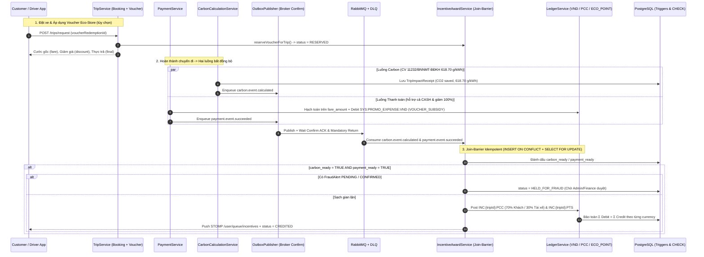

---

## II. Bảng Chi tiết Các Tính Năng Đã Hoàn Thành

### 1. Phân hệ Backend (Spring Boot 3.3.3 + PostgreSQL/PostGIS + RabbitMQ + Redis + ShedLock)

| STT | Tính năng / Thành phần | Chi tiết Kỹ thuật đã triển khai | Trạng thái |
| :---: | :--- | :--- | :---: |
| **1.1** | **Flyway Migration `V6` (`V6__sprint6_incentive_ledger.sql`)** | Mở rộng `ledger_accounts` (`frozen_reason`, `frozen_by`, `frozen_at`, `chk_ledger_account_status`), cài trigger `trg_check_tx_single_currency`, chuẩn hóa `emission_factors` 2024 (`618.70 g/kWh` + 2 ràng buộc `CHECK`), chuyển scale `rewards.carbon_credit_cost` & `reward_redemptions.carbon_spent` sang `NUMERIC(18,4)`, tạo bảng `trip_incentive_awards`, `carbon_conversions`, seed 8 tài khoản `SYS:*`, backfill ví `PCC`/`ECO_POINT` cho `CUSTOMER`/`DRIVER`, seed 9 `platform_settings` và 7 quà Eco-Store. | **ĐÃ HOÀN THÀNH** |
| **1.2** | **Tái cấu trúc Core Sổ cái & Platform (`modules.ledger`, `common.platform`)** | Chuyển `LedgerService`, `LedgerAccount/Entry/Transaction`, `LedgerAuditService`, `AdminLedgerAuditController`, `OutboxPublisher`, `IdempotencyService`, `PlatformSettingsService` về package độc lập tránh vòng phụ thuộc với `payment` và `incentive`. `IdempotencyService` ép buộc `Idempotency-Key` (`422`) ở các endpoint tài chính quan trọng. | **ĐÃ HOÀN THÀNH** |
| **1.3** | **Join-Barrier Điều phối Thưởng (`IncentiveAwardService`)** | Khởi tạo an toàn bằng `INSERT ... ON CONFLICT DO NOTHING` + `SELECT ... FOR UPDATE`; xử lý mượt cả 2 thứ tự sự kiện (`Carbon` trước hay `Payment` trước); chặn giải ngân vào `HELD_FOR_FRAUD` nếu tồn tại `FraudAlert` `PENDING`/`CONFIRMED`; Admin duyệt (`CREDITED`) hoặc hủy (`VOIDED_FRAUD`) kèm `audit_logs`. | **ĐÃ HOÀN THÀNH** |
| **1.4** | **Eco-Store, Vòng đời Voucher & Quy đổi `PCC → VND`** | `EcoStoreService`: `decrementStockAtomic` chống oversell 200 luồng, hủy đổi quà `AVAILABLE` (`REWARD_CANCEL_REVERSAL`), `previewVoucher` / `reserveVoucherForTrip` / `markVoucherUsedForTrip` / `releaseVoucherForCancelledTrip`. `IncentiveWalletService`: quy đổi `PCC → VND` (`PCC_CONVERT_BURN` + `PCC_CONVERT_PAYOUT`) khóa `FOR UPDATE` theo số tài khoản trước khi nạp L1 cache để serialize giới hạn trần tháng. | **ĐÃ HOÀN THÀNH** |
| **1.5** | **Độ tin cậy Outbox & Tự động Đối soát (`OutboxPublisher`, `IncentiveReconciliationJob`)** | `OutboxPublisher` chờ Broker Confirm ACK (`CorrelationData.getFuture().get(5s)`) và kiểm tra `getReturned() == null` mới đánh dấu `SENT`; quá 10 lần chuyển `FAILED` chờ `AdminOutboxController` (`/admin/outbox/failed`, `/{id}/redrive`, `/redrive-all`). `IncentiveReconciliationJob` dùng ShedLock tự động đối soát award kẹt `PENDING_CONDITIONS` quá N phút. | **ĐÃ HOÀN THÀNH** |
| **1.6** | **Thanh toán Nợ kỹ thuật Sprint 4–5 & Sửa lỗi Live E2E** | Bổ sung trợ giá `VOUCHER_SUBSIDY` từ `SYS:PROMO_EXPENSE:VND` (kể cả `CASH` và cuốc giảm 100% vẫn phát `payment.event.succeeded`); tính hoa hồng trên `fare_amount`; sửa IDOR `TripController`/`TripService`; thay aggregation tài chính bằng SQL thuần; bổ sung `userDetails.isEnabled()` trong `JwtAuthenticationFilter` và chuẩn hóa lỗi Circuit-Breaker `409 REDEMPTION_FROZEN_CIRCUIT_BREAKER`. | **ĐÃ HOÀN THÀNH** |

---

### 2. Phân hệ Cổng Quản trị Web Admin (`frontend-admin` — Next.js 14 + TailwindCSS + Recharts)

| STT | Giao diện / Tính năng | Chi tiết Kỹ thuật đã triển khai | Trạng thái |
| :---: | :--- | :--- | :---: |
| **2.1** | **Quản trị Eco-Store & Tham số Khuyến khích (`/incentives/catalog`)** | CRUD danh mục ưu đãi 3 nhóm (`VOUCHER_RIDE`, `TREE_PLANTING`, `ECO_PRODUCT`), cấu hình live tỷ lệ chia PCC `70/30`, tỷ giá `500 đ/PCC`, mức tối thiểu `0.5000 PCC`, trần tháng `100.0000 PCC` và chu kỳ reconciliation; tích hợp `ToastProvider` thay `alert()` và ẩn/khóa thao tác ghi với `ROLE_OPERATOR`. | **ĐÃ HOÀN THÀNH** |
| **2.2** | **Kiểm toán Sổ cái Đa Tiền tệ & Điều phối (`/incentives/ledger-audit`)** | Hiển thị 3 thẻ bất biến Zero-Sum (`VND`, `PCC`, `ECO_POINT`), đếm giao dịch lệch/trộn tiền tệ/drift, nút bật/tắt `Circuit-Breaker`, bảng tra cứu giao dịch kèm modal chi tiết bút toán `DEBIT`/`CREDIT`, đảo giao dịch `ADMIN_REVERSAL` (`Idempotency-Key`), duyệt/hủy `HELD_FOR_FRAUD` và re-drive Outbox `FAILED`. | **ĐÃ HOÀN THÀNH** |
| **2.3** | **Đóng băng Ví Carbon tại `/fraud-monitor` & RBAC 3 Vai trò** | Tích hợp trực tiếp nút `Đóng băng` / `Mở khóa` Ví Carbon tại màn hình `/fraud-monitor`; phân quyền RBAC trên `auth.tsx` & `Sidebar.tsx` cho `ROLE_ADMIN`, `ROLE_FINANCE` (đầy đủ quyền) và `ROLE_OPERATOR` (chỉ xem kèm huy hiệu khóa). | **ĐÃ HOÀN THÀNH** |
| **2.4** | **Dọn sạch Dữ liệu Mock Sprint 4–5 & Sửa DTO Mapping Live** | Thay dữ liệu mock ở `/emissions` (cập nhật KPI CV 11232/BNNMT-BĐKH `618.70 g/kWh`), `/finance` (gọi API overview/charts thật thay fallback tĩnh), `/eco/certificate/[slug]` (gọi `GET /carbon/receipts/share/{slug}` thật), bổ sung `Idempotency-Key` ở `/payments`. Trong quá trình Live E2E đã phát hiện và sửa 4 lỗi khớp trường DTO (`totalsByCurrency`, `accountDiscrepanciesCount`, `totalAmount`, mảng phẳng `/admin/outbox/failed`, `attempts`). | **ĐÃ HOÀN THÀNH** |

---

### 3. Phân hệ Ứng dụng Di động (`mobile/` — Flutter Dark Mode + `core_model`, `core_network`, `core_ui`)

| STT | Thành phần / Màn hình | Chi tiết Kỹ thuật đã triển khai | Trạng thái |
| :---: | :--- | :--- | :---: |
| **3.1** | **Đồng bộ Core Packages & Vá lỗi API Sprint 5** | Bổ sung đầy đủ models & API client cho `CarbonApi`, `IncentiveApi` (`core_model`, `core_network`); sửa mapping `WalletBalanceModel`, `WalletTransactionModel.isCredit`, `DriverEarningsSummaryModel`, thêm `Idempotency-Key` tự động ở `wallet_api.dart`, `payment_api.dart`, `AuthApi.getCurrentUser()`; bổ sung formatter `PCC` 4 chữ số thập phân ở `core_ui`. | **ĐÃ HOÀN THÀNH** |
| **3.2** | **Ứng dụng Khách hàng (`customer_app` — 4 Tab Dark Mode)** | Cấu trúc `BottomNavigationBar` 4 tab (`Đặt xe`, `Ví & Carbon`, `Eco-Store`, `Tài khoản`) theo tông Dark Mode `#0F172A` / Emerald. Hoàn thiện `WalletScreen` (hai tab `Biến động VNĐ` & `Sổ cái PCC & Điểm Xanh`, modal quy đổi `PCC → VNĐ`), `EcoStoreScreen` (đổi quà, `Ưu đãi của tôi`, hủy voucher), `RideBookingScreen` (chọn voucher trước đặt xe), `PaymentScreen` & `ImpactReceiptScreen`. | **ĐÃ HOÀN THÀNH** |
| **3.3** | **Ứng dụng Tài xế (`driver_app` — `DriverShellScreen` 4 Tab Dark Mode)** | Xây dựng `DriverShellScreen` 4 tab (`Nhận chuyến`, `Thu nhập`, `Carbon`, `Tài khoản`), `DriverCarbonScreen` (quy đổi PCC phần 30% sang `DRIVER_EARNINGS`), sửa lỗi compile `Colors.emerald` tại `EarningsScreen`, viết lại `EarningsScreen`, `DriverWalletScreen`, `CashCollectedDialog` theo Dark Mode và sửa `AuthCubit.checkAuthStatus()` qua `/auth/me`. | **ĐÃ HOÀN THÀNH** |

---

## III. Các Đột Phá Kỹ Thuật & Kiến Trúc Trọng Tâm

### 1. Ma trận Hệ số Phát thải Chuẩn 2024 — Công văn 11232/BNNMT-BĐKH

Tất cả tính toán ở cả Backend và Web Admin được đồng nhất theo Công văn **11232/BNNMT-BĐKH** (hệ số phát thải lưới điện Việt Nam năm 2024: $EF_{\text{grid}} = 618.70\;\text{gCO}_2/\text{kWh}$; số liệu tham chiếu năm 2023 là $659.20\;\text{gCO}_2/\text{kWh}$), thỏa mãn tuyệt đối 2 ràng buộc `CHECK` trong PostgreSQL (`EV = ROUND(SEC × EF_grid, 2)` và `Net Saving = Baseline − EV`):

| Loại xe (`vehicle_category`) | Baseline xe xăng ($\text{gCO}_2/\text{km}$) | Tiêu thụ điện `SEC` ($\text{kWh}/\text{km}$) | Hệ số lưới `EF_grid` ($\text{gCO}_2/\text{kWh}$) | Phát thải gián tiếp EV ($\text{gCO}_2/\text{km}$) | Giảm phát thải ròng `Net Saving` ($\text{gCO}_2/\text{km}$) |
| :--- | :---: | :---: | :---: | :---: | :---: |
| **`ELECTRIC_MOTORBIKE`** | `68.50` | `0.0320` | `618.70` | `19.80` | **`48.70`** |
| **`ELECTRIC_CAR_4SEAT`** | `152.00` | `0.1350` | `618.70` | `83.52` | **`68.48`** |
| **`ELECTRIC_CAR_7SEAT`** | `210.00` | `0.1800` | `618.70` | `111.37` | **`98.63`** |

### 2. Sổ cái Đa tiền tệ Zero-Sum, Chia Thưởng 70/30 & Bảo toàn 100% $\text{CO}_2$

Hệ thống duy trì 3 sổ cái độc lập trên cùng kiến trúc Double-Entry, bảo đảm bất biến với mọi loại tiền tệ $c \in \{\text{VND}, \text{PCC}, \text{ECO\_POINT}\}$:

$$
\sum_{e \in \text{Debit}(c)} e.\text{amount} = \sum_{e \in \text{Credit}(c)} e.\text{amount} \implies \Delta_{\text{System}}(c) = 0.0000
$$

**Quy tắc quy đổi & chia thưởng sau chuyến đi** ($1\;\text{PCC} = 1{,}000\;\text{g CO}_2$, quy đổi ở cấp độ $100\%$ lượng $\text{CO}_2$ tiết kiệm):

$$
T = \left\lfloor \frac{\Delta E_{\text{CO}_2}}{1000} \right\rfloor_{4}, \qquad C = \left\lfloor T \times 0.70 \right\rfloor_{4}, \qquad D = T - C
$$

- Mọi sai số làm tròn ở chữ số thập phân thứ 4 luôn cộng gộp chính xác ($C + D = T$), bỏ qua bút toán có giá trị bằng `0` để không vi phạm `amount > 0`.
- **Eco-Points**: $\text{customerPoints} = \max\left(1, \lfloor \Delta E_{\text{CO}_2} / 100 \rfloor\right)$ và nếu có tài xế hoàn thành cuốc xe, $\text{driverPoints} = \max\left(1, \lfloor \text{customerPoints} \times 0.50 \rfloor\right)$.
- **Idempotency-Key cố định**: `INC:{tripId}:PCC`, `INC:{tripId}:PTS`, `CLAWBACK:{tripId}:PCC`, `CLAWBACK:{tripId}:PTS`.

### 3. Hạch toán Trợ giá Voucher (`SYS:PROMO_EXPENSE:VND`) cho Cả 4 Phương thức

Đảm bảo tài xế và hoa hồng sàn luôn được tính trên **cước gốc** $F_{\text{gross}} = \text{fare\_amount}$ ($C_{\text{comm}} = 20\% \times F_{\text{gross}}$, $D_{\text{net}} = 80\% \times F_{\text{gross}}$), còn phần giảm giá $V = \text{discount\_amount}$ được hạch toán rõ ràng vào tài khoản chi phí khuyến mãi `SYS:PROMO_EXPENSE:VND`:
- **Ví Xanh / Cổng thanh toán (`amount_vnd` $> 0$)**: Debit `USER_WALLET` hoặc `GATEWAY_CLEARING` $= F_{\text{net}}$ + Debit `SYS:PROMO_EXPENSE:VND` $= V$; Credit `DRIVER_EARNINGS` $= D_{\text{net}}$ + Credit `PLATFORM_REVENUE` $= C_{\text{comm}}$.
- **Tiền mặt (`CASH` có voucher)**: Thu hoa hồng sàn bình thường trên `F_gross` (Debit `DRIVER_EARNINGS` $= C_{\text{comm}}$, Credit `PLATFORM_REVENUE` $= C_{\text{comm}}$) và bổ sung bút toán **`VOUCHER_SUBSIDY`**: Debit `SYS:PROMO_EXPENSE:VND` $= V$, Credit `DRIVER_EARNINGS` $= V$.
- **Giảm giá 100% (`final_amount = 0`)**: Tự động quyết toán `settleZeroFarePayment()` bằng bút toán `VOUCHER_SUBSIDY` từ `SYS:PROMO_EXPENSE:VND` trả đủ $D_{\text{net}} + C_{\text{comm}}$ và vẫn phát sự kiện `payment.event.succeeded` vào Outbox để kích hoạt thưởng Carbon.

### 4. Khóa Bi quan `FOR UPDATE` Trước L1 Cache & Các Trường hợp Biên

- **Chống `StaleObjectStateException` khi quy đổi PCC→VND đồng thời**: Thực nghiệm Testcontainers đa luồng phát hiện nếu đọc `LedgerAccount` trước rồi mới `findByIdWithLock`, Hibernate sẽ so khớp `@Version` cũ trong L1 Cache khi transaction trước vừa commit. Đã khắc phục dứt điểm bằng truy vấn `findByAccountNumberWithLock` lấy khóa `SELECT ... FOR UPDATE` **ngay từ câu lệnh đọc đầu tiên** trong transaction (`IncentiveWalletService`).
- **Xử lý đầy đủ các trường hợp biên (`Edge Cases`)**:
  - *Refund 1 phần*: Không thu hồi PCC/PTS, ghi `audit_logs` (`PARTIAL_REFUND_INCENTIVE_UNCHANGED`).
  - *Refund toàn phần sau khi đã đổi PCC sang VNĐ*: Chuyển trạng thái award sang `CLAWBACK_SHORTFALL_AUDIT`, tuyệt đối **không tự trừ ngược ví tiền VNĐ**.
  - *Voucher hết hạn khi đang `RESERVED`*: Nếu chuyến hoàn thành thì vẫn được áp dụng (`USED`); chỉ chuyển `EXPIRED` nếu chuyến bị hủy sau `expires_at`.
  - *Fraud alert đến muộn sau khi đã `CREDITED`*: Chỉ xử lý thủ công qua `ADMIN_REVERSAL` kèm đóng băng ví, không tự clawback.

---

## IV. Minh chứng Giao diện Thực tế (Live E2E Screenshots)

Toàn bộ ảnh dưới đây được chụp tự động từ phiên chạy thực tế (**Live E2E**) bằng Playwright Chromium trên cụm **Backend Spring Boot (`:8080`) + Web Admin Next.js (`:3000`) + Customer Flutter Web (`:3001`) + Driver Flutter Web (`:3002`)** kết nối Docker (`PostgreSQL/PostGIS + RabbitMQ + MongoDB + Redis`), ghi nhận **0 lỗi console và 0 lỗi HTTP bất thường**.

### 1. Cổng Quản trị Web Admin (`frontend-admin`)

#### 1.1. Danh mục Quà & Voucher Eco-Store (`/incentives/catalog`)
Hiển thị đầy đủ 7 ưu đãi thuộc 3 danh mục (`VOUCHER_RIDE`, `TREE_PLANTING`, `ECO_PRODUCT`), chi phí PCC 4 chữ số thập phân, Eco-Points và tồn kho trực tiếp từ PostgreSQL:

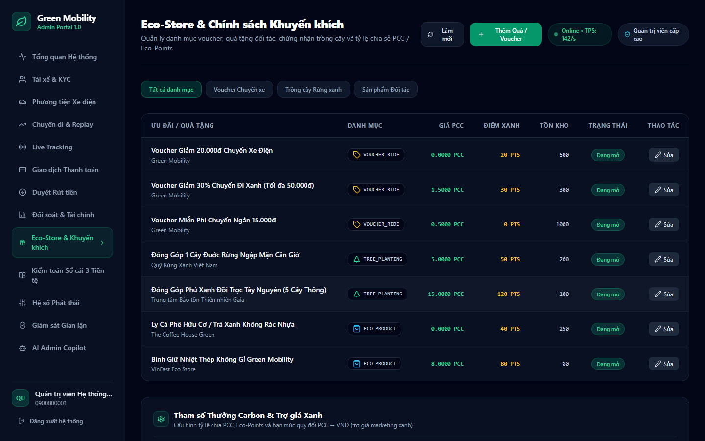

#### 1.2. Modal Tạo Mới Ưu đãi Eco-Store (`/incentives/catalog`)
Biểu mẫu tạo mới voucher/quà tặng với cấu hình loại giảm giá (`FIXED_VND`/`PERCENT`), giá trị tối đa, chi phí PCC scale 4 và giới hạn mỗi người dùng:

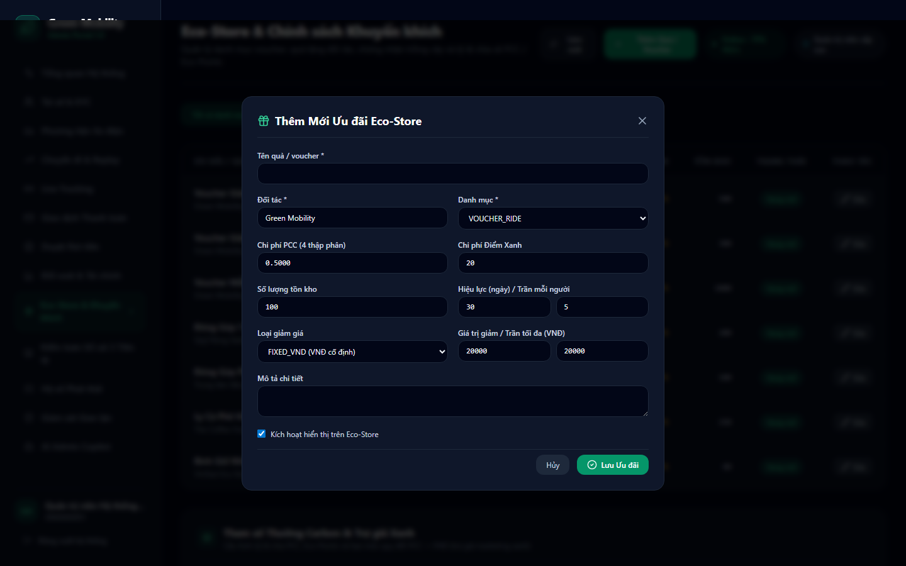

#### 1.3. Kiểm toán Sổ cái Đa Tiền tệ & Circuit-Breaker (`/incentives/ledger-audit`)
Ba thẻ kiểm toán Zero-Sum xác nhận $\Delta = 0$ cho `VND`, $\Delta = 0.0000$ cho `PCC` và $\Delta = 0$ cho `ECO_POINT`, kèm bộ lọc và danh sách giao dịch sổ cái:

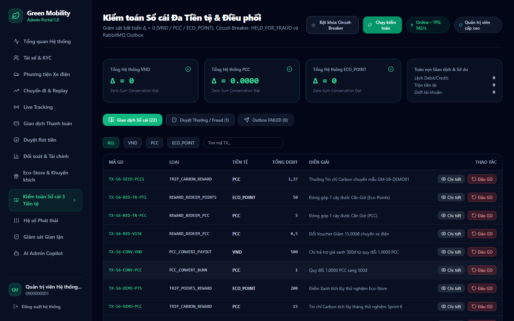

#### 1.4. Modal Chi tiết Bút toán Đối ứng `DEBIT` / `CREDIT` (`TX-S6-SEED-PCC1`)
Truy vết bút toán chia thưởng 70/30 (`SYS:CARBON_RESERVE:PCC` ghi Nợ `1.3696`, ví Khách ghi Có `0.9587 PCC` và ví Tài xế ghi Có `0.4109 PCC`):

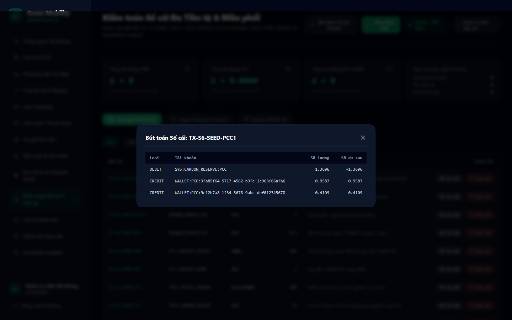

#### 1.5. Hàng đợi Duyệt Thưởng Tạm giữ `HELD_FOR_FRAUD` (`/incentives/ledger-audit`)
Hiển thị cuốc xe bị Join-Barrier tạm giữ do cảnh báo gian lận GPS (Risk 84.5) với đầy đủ trạng thái `C:OK / P:OK` và nút `Duyệt` / `Hủy thưởng` cho `ADMIN`/`FINANCE`:

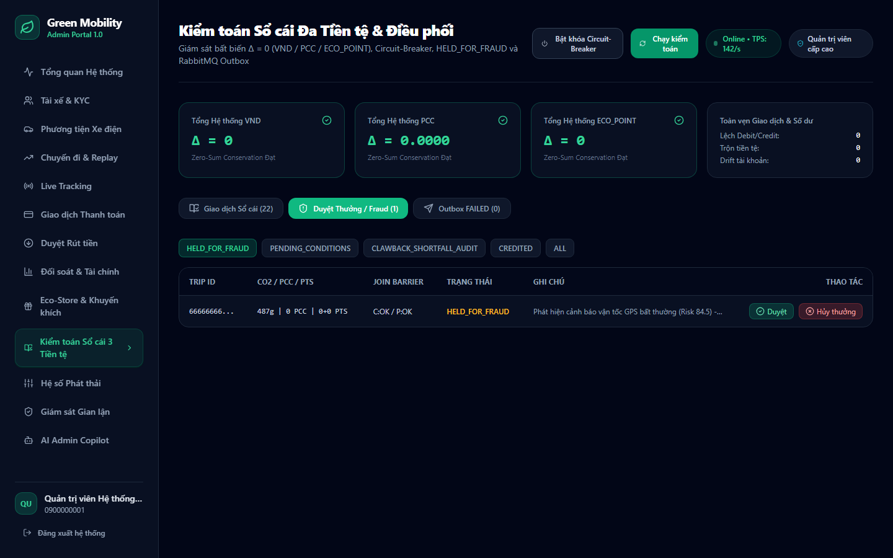

#### 1.6. Ma trận Hệ số Phát thải 2024 CV 11232/BNNMT-BĐKH (`/emissions`)
Thẻ KPI cập nhật chuẩn lưới điện quốc gia **2024 (`618.70 g/kWh`)** và mức giảm ròng mới (`+48.70 g/km` xe máy điện; `68.48 – 98.63 g/km` ô tô điện 4 & 7 chỗ):

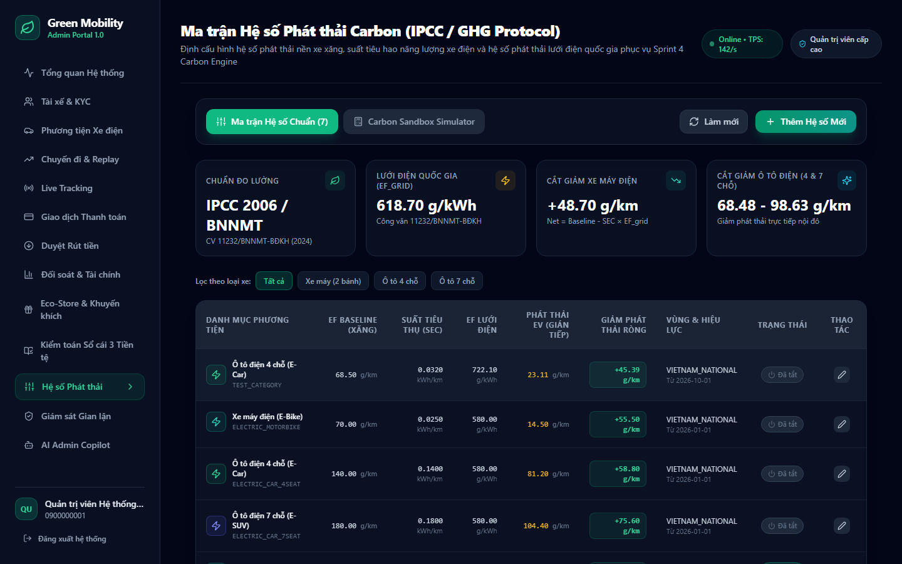

#### 1.7. Trung tâm Giám sát Gian lận & Khóa Ví Carbon (`/fraud-monitor`)
Hiển thị cảnh báo vận tốc GPS bất thường (`GPS_VELOCITY_ANOMALY`, Risk `84.5%`) liên kết trực tiếp chuyến xe mẫu Sprint 6 phục vụ điều hành rà soát và khóa ví:

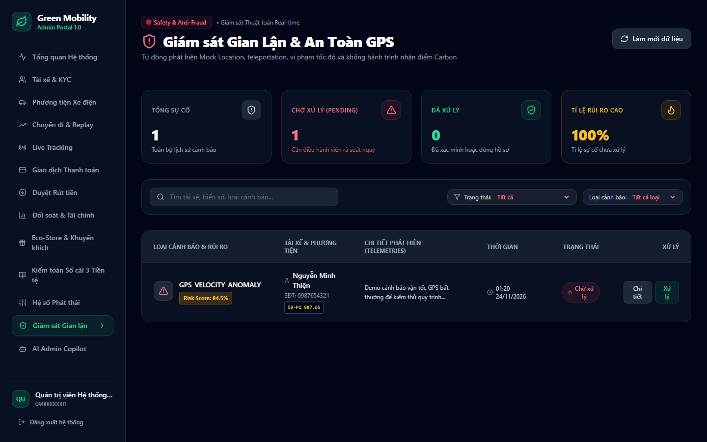

#### 1.8. Phân quyền Chỉ xem dành cho Điều phối viên (`ROLE_OPERATOR`)
Khi đăng nhập bằng tài khoản `0900000003` (`ROLE_OPERATOR`), hệ thống hiển thị huy hiệu `Chỉ xem (Operator)` và ẩn hoàn toàn các nút thao tác ghi (`Circuit-Breaker`, `Đảo GD`, `Duyệt`/`Hủy`):

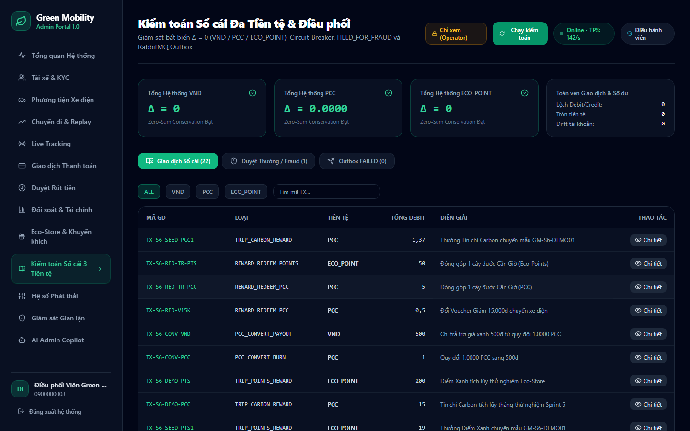

---

### 2. Cổng Chứng nhận Xanh Công khai (`/eco/certificate/gm-s6-demo-01`)

Truy vấn trực tiếp API công khai `GET /carbon/receipts/share/gm-s6-demo-01` cho chuyến ô tô điện 4 chỗ 20 km (`1369.60 g CO₂` tiết kiệm ròng, `+1.3696 PCC`, `+13 Eco-Points`, quy đổi `22.8` ngày cây xanh & `221.4` giờ đèn LED):

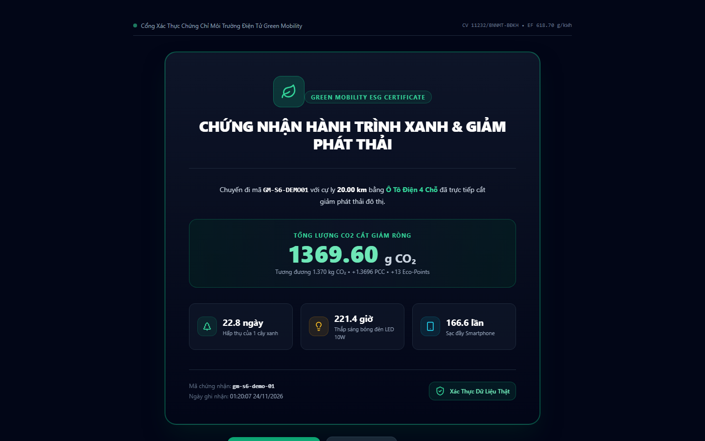

---

### 3. Ứng dụng Di động Khách hàng (`customer_app` — Dark Mode)

#### 3.1. Ví Xanh, Tín chỉ Carbon (PCC) & Điểm Xanh (`WalletScreen`)
Giao diện Dark Mode hiển thị đồng bộ số dư VNĐ (`350.500 đ`), `4.4587 PCC`, `113 PTS`, nút quy đổi `PCC → VNĐ` và 2 tab sổ cái (`Biến động VNĐ` / `Sổ cái PCC & Điểm Xanh`):

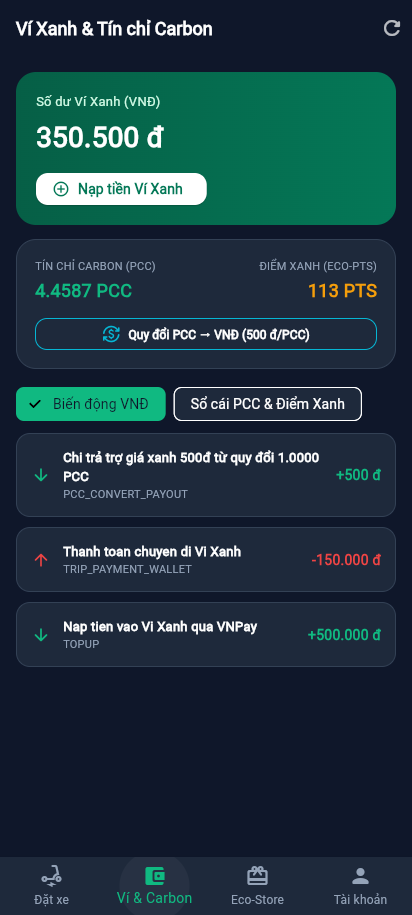

#### 3.2. Modal Quy đổi Tín chỉ Carbon sang VNĐ
Hiển thị tỷ giá trợ giá `500 đ / 1 PCC`, mức tối thiểu `0.5 PCC` và hạn mức trần tháng còn lại (`99.0000 PCC`) theo thời gian thực:

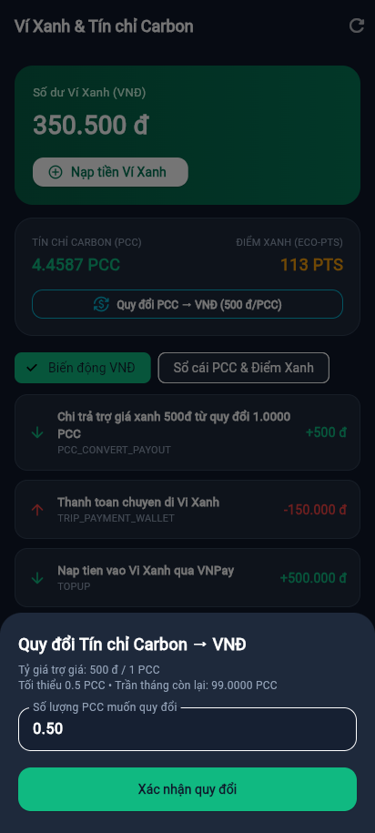

#### 3.3. Cửa hàng Đổi thưởng Eco-Store (`EcoStoreScreen`)
Danh mục 7 quà tặng/voucher chia nhóm lọc trực quan, hiển thị số dư PCC/PTS và nút `Đổi ngay`:

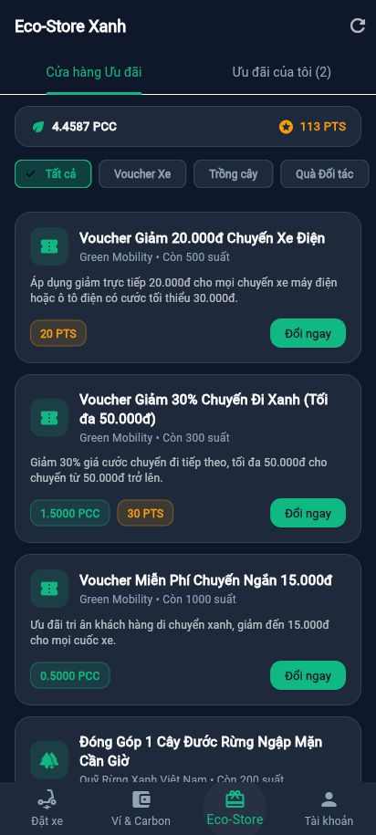

#### 3.4. Ví Ưu đãi Cá nhân (`Ưu đãi của tôi`)
Hiển thị mã voucher khả dụng (`GM-DEMO15K`, trạng thái `AVAILABLE` kèm nút `Hủy & Hoàn PCC/PTS`) và chứng nhận trồng cây (`GM-TREE01`, `COMPLETED`):

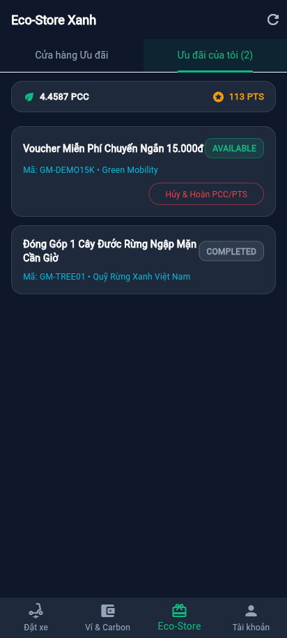

#### 3.5. Đặt xe Điện & Áp dụng Voucher Eco-Store (`RideBookingScreen`)
Màn hình đặt xe Dark Mode hiển thị ước tính phát thải giảm theo từng dòng xe (`815g` / `977g` / `1.25 kg CO₂`) và mục `Áp dụng Voucher (1 mã khả dụng)`:

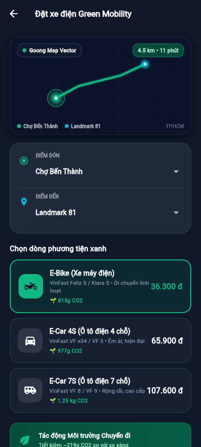

---

### 4. Ứng dụng Di động Tài xế (`driver_app` — Dark Mode)

#### 4.1. Ví Carbon Tài xế 30% (`DriverCarbonScreen`)
Hiển thị phần chia 30% Tín chỉ Carbon & Eco-Points của tài xế (`5.4109 PCC`, `56 PTS`), nút quy đổi trực tiếp sang tài khoản thu nhập `DRIVER_EARNINGS` và lịch sử biến động từng chuyến:

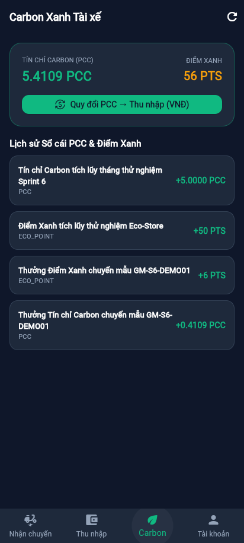

#### 4.2. Màn hình Thu nhập Tài xế (`EarningsScreen` Dark Mode)
Giao diện Dark Mode đã đồng bộ sửa lỗi `Colors.emerald` và cập nhật đúng cấu trúc lịch sử thu nhập (`#GM-DEMO-MOMO-04`, `#GM-DEMO-VNPAY-03`, `#GM-DEMO-WALLET-02`):

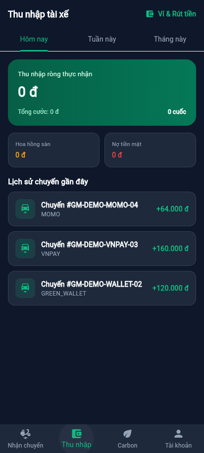

---

## V. Bảng Đối chiếu Tiêu chí Nghiệm thu Sprint 6 (`AC-01` đến `AC-24`)

Toàn bộ **24 tiêu chí nghiệm thu (`AC-01` đến `AC-24`)** đặc tả trong [SPRINT_6_SPEC.md](./SPRINT_6_SPEC.md) đã vượt qua kiểm thử tự động (**102/102 Maven Unit + Testcontainers Integration Tests PASS**) và xác thực thực tế qua **Live E2E**:

| Mã AC | Nghiệp vụ Kiểm thử | Bằng chứng Kiểm thử Thực tế (`Sprint6IncentiveUnitTest` / `Sprint6IntegrationTest` / Live E2E) | Đánh giá |
| :---: | :--- | :--- | :---: |
| **AC-01** | Hệ số phát thải 2024 CV 11232/BNNMT-BĐKH (`618.70 g/kWh`) | Query bảng `emission_factors` khớp `48.70 / 68.48 / 98.63`; insert sai công thức bị DB `CHECK` chặn; Web `/emissions` hiển thị `618.70 g/kWh`. | **PASS** |
| **AC-02** | Sổ cái đa tiền tệ tách biệt (`VND`, `PCC`, `ECO_POINT`) | Trigger `trg_check_tx_single_currency` và `LedgerService.post()` chặn mọi giao dịch trộn tiền tệ (`LEDGER_INVALID_CURRENCY`) hoặc lệch tổng Nợ/Có (`LEDGER_UNBALANCED`). | **PASS** |
| **AC-03** | Bất biến sổ cái ở tầng Database | `UPDATE ledger_transactions` và `DELETE FROM ledger_entries` bị trigger `trg_ledger_immutable` từ chối 100% trong `Sprint6IntegrationTest`. | **PASS** |
| **AC-04** | Join-Barrier thứ tự Carbon đến trước Payment | `onCarbonCalculated` đưa award vào `PENDING_CONDITIONS` (`carbonReady=true`); `onPaymentSucceeded` sau đó kích hoạt `CREDITED` đủ PCC & Eco-Points. | **PASS** |
| **AC-05** | Join-Barrier thứ tự Payment đến trước Carbon | `onPaymentSucceeded` -> `PENDING_CONDITIONS`; `onCarbonCalculated` -> `CREDITED`; gọi lặp lại `onPaymentSucceeded` trả về cùng `pccLedgerTxId` (idempotent). | **PASS** |
| **AC-06** | Chia PCC 70/30 `floor(4)`, không đếm trùng & bỏ entry `0` | Unit test kiểm chứng `333.33g` -> `0.2333 + 0.1000 = 0.3333` và `0.05g` (`T=0.0000`) bỏ qua bút toán PCC; khóa ledger cố định `INC:{tripId}:PCC` & `INC:{tripId}:PTS`. | **PASS** |
| **AC-07** | Tạm giữ khi có cảnh báo gian lận (`FraudAlert`) | Chuyến có `FraudAlert` `PENDING` chuyển award sang `HELD_FOR_FRAUD`, không cộng điểm trước khi rà soát. | **PASS** |
| **AC-08** | Admin duyệt / hủy `HELD_FOR_FRAUD` | `POST /admin/incentive/awards/{id}/approve` (Admin) giải ngân thành công -> `CREDITED`; `POST .../void` (Finance) chuyển -> `VOIDED_FRAUD` kèm `audit_logs`. | **PASS** |
| **AC-09** | Hoàn tiền toàn phần, thiếu số dư & hoàn tiền 1 phần | Full refund đủ dư -> `INCENTIVE_CLAWBACK`; đã tiêu/đổi PCC -> `CLAWBACK_SHORTFALL_AUDIT` & không trừ ngược VNĐ; Partial refund -> giữ nguyên thưởng + ghi audit. | **PASS** |
| **AC-10** | Fraud alert đến muộn sau khi đã `CREDITED` | Không tự động clawback; Admin xử lý bằng `POST /admin/ledger/transactions/{id}/reverse` sinh giao dịch `ADMIN_REVERSAL`. | **PASS** |
| **AC-11** | Đổi quà Eco-Store nguyên tử dưới 200 luồng đồng thời | 200 luồng tranh mua 10 suất quà trong Testcontainers: đúng **10 thành công**, **190 trả về `REWARD_OUT_OF_STOCK`**, `quantityAvailable = 0`, 0 âm ví, 0 deadlock. | **PASS** |
| **AC-12** | Hủy đổi quà `AVAILABLE` hoàn PCC/Eco-Points & tồn kho | `POST /incentive/redemptions/{id}/cancel` tăng tồn kho +1, ghi `REWARD_CANCEL_REVERSAL` hoàn đủ `0.5000 PCC` và điểm. | **PASS** |
| **AC-13** | Vòng đời Voucher đặt chuyến & quá hạn khi đang `RESERVED` | Hủy chuyến trả voucher về `AVAILABLE`; voucher vừa quá `expires_at` trong khi đang `RESERVED` vẫn cho hoàn tất chuyến (`USED`), và thành `EXPIRED` nếu chuyến hủy. | **PASS** |
| **AC-14** | Trợ giá `SYS:PROMO_EXPENSE:VND` (gồm `CASH` & giảm 100%) | Cuốc `CASH` giảm `20,000đ` trên `50,000đ` cước gốc ghi đúng `VOUCHER_SUBSIDY` `+20,000đ` & hoa hồng `-10,000đ`; cuốc giảm 100% (`final=0`) settle `PAID` và phát `payment.event.succeeded`. | **PASS** |
| **AC-15** | Quy đổi `PCC → VND` cho Khách/Tài xế & Trần tháng | Driver quy đổi vào `DRIVER_EARNINGS`; 3 luồng Customer đồng thời quy đổi `45 PCC` với trần `100 PCC`: 2 thành công (`90 PCC`), 1 chặn `PCC_MONTHLY_CAP_EXCEEDED`, 0 lỗi optimistic lock. | **PASS** |
| **AC-16** | Đóng băng Ví Carbon & mã lỗi `409 WALLET_FROZEN` | Admin đóng băng ví trả về `409 WALLET_FROZEN` khi quy đổi; mở khóa khôi phục giao dịch bình thường. | **PASS** |
| **AC-17** | Circuit-Breaker toàn hệ thống | Bật Circuit-Breaker qua API khiến đổi quà/quy đổi trả ngay `409 REDEMPTION_FROZEN_CIRCUIT_BREAKER`. | **PASS** |
| **AC-18** | Admin đảo giao dịch `ADMIN_REVERSAL` & chống đảo 2 lần | Lý do `< 10` ký tự bị từ chối (`400`); hợp lệ sinh `ADMIN_REVERSAL`; đảo lần 2 trả về `409 LEDGER_ALREADY_REVERSED`. | **PASS** |
| **AC-19** | Outbox Publisher Confirm ACK & Admin Re-drive `FAILED` | Outbox chỉ đánh dấu `SENT` khi RabbitMQ ACK & không bị trả lại (`NO_ROUTE`); sự kiện `FAILED` liệt kê tại `/admin/outbox/failed` và `/redrive` khôi phục `NEW`. | **PASS** |
| **AC-20** | Job đối soát tự động `IncentiveReconciliationJob` | Award kẹt `PENDING_CONDITIONS` quá ngưỡng phút được `IncentiveReconciliationJob` tự phát hiện và giải ngân từ receipt + payment thật. | **PASS** |
| **AC-21** | RBAC 3 vai trò, IDOR, `Idempotency-Key=422`, User khóa & Refresh token | `OPERATOR` `GET=200` / `POST=403`; user A hủy redemption của B `404`; thiếu `Idempotency-Key` trả `422`; refresh token & user `SUSPENDED` (kể cả JWT đã cấp) đều bị chặn; đăng ký mới tự cấp ví PCC/PTS. | **PASS** |
| **AC-22** | Web Admin Sprint 6 & dọn nợ Sprint 4–5 | `npm run lint`, `tsc --noEmit` & `next build` xanh (18 routes); 9 ảnh Web Admin + Chứng chỉ công khai kiểm chứng live mượt mà. | **PASS** |
| **AC-23** | Mobile Customer & Driver Dark Mode End-to-End | `flutter analyze --no-fatal-infos && flutter test` xanh trên `core_model`, `core_network`, `core_ui`, `customer_app`, `driver_app`; 7 ảnh Live E2E hiển thị dữ liệu thật không lỗi console. | **PASS** |
| **AC-24** | Seed Demo Idempotent & Kiểm toán Tổng thể `Δ = 0.0000` | Chạy lặp lại `seed_sprint6_demo_data.py` + kiểm tra cả Testcontainers lẫn Live Runtime `GET /admin/ledger/audit`: `isBalanced = true`, **`VND = 0.0000`, `PCC = 0.0000`, `ECO_POINT = 0.0000`**. | **PASS** |

---

## VI. Kết luận & Sẵn sàng Chuyển tiếp Sprint 7

1. **Tổng kết Thành quả Sprint 6**:
   - Đã hoàn thiện toàn diện hệ thống **Điểm thưởng & Tín chỉ Carbon (`PCC` / `ECO_POINT`)** trên nền tảng **Sổ cái Kế toán Kép Đa tiền tệ Bất biến**, chuẩn hóa hoàn toàn số liệu theo **Công văn 11232/BNNMT-BĐKH (`618.70 gCO₂/kWh`)**.
   - Giải quyết dứt điểm nợ kỹ thuật tồn đọng của Sprint 4–5, khắc phục triệt để các lỗi đồng thời (`StaleObjectStateException`), bảo mật JWT cho tài khoản bị khóa và đồng bộ DTO Web Admin qua quá trình kiểm thử Testcontainers + Live E2E thực tế.
   - Đạt **102/102 bài kiểm thử Backend PASS**, **Web Admin build sạch 18 routes**, **Mobile Apps pass `flutter analyze` & `flutter test`**, và kiểm toán sổ cái kép cả trên môi trường Testcontainers lẫn Live Runtime đều đạt **$\Delta = 0.0000$ cho cả 3 loại tiền tệ `VND`, `PCC`, `ECO_POINT`**.

2. **Kế hoạch Chuyển tiếp Sprint 7 (Dashboard Báo cáo & Gamification)**:
   - Xây dựng **Bảng xếp hạng Xanh (`Green Leaderboard`)**, **Huy hiệu Thành tựu (`Eco Badges`)** và chuỗi thói quen di chuyển xanh (`Green Streaks`) dựa trên sự kiện RabbitMQ `incentive.event.credited` & `incentive.event.redeemed` mà Outbox Sprint 6 đã xuất bản sẵn sang queue `q.incentive.events`.
   - Tổng hợp báo cáo tác động môi trường định kỳ (Aggregation) theo tuần/tháng/năm cho hành khách, tài xế và báo cáo ESG cấp toàn hệ thống trên Web Admin.
